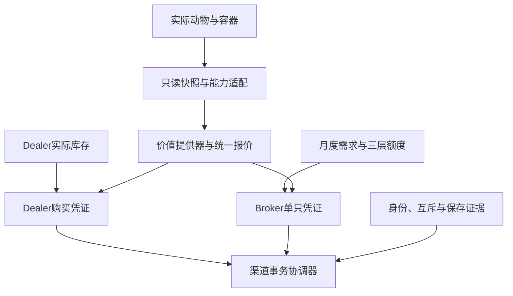
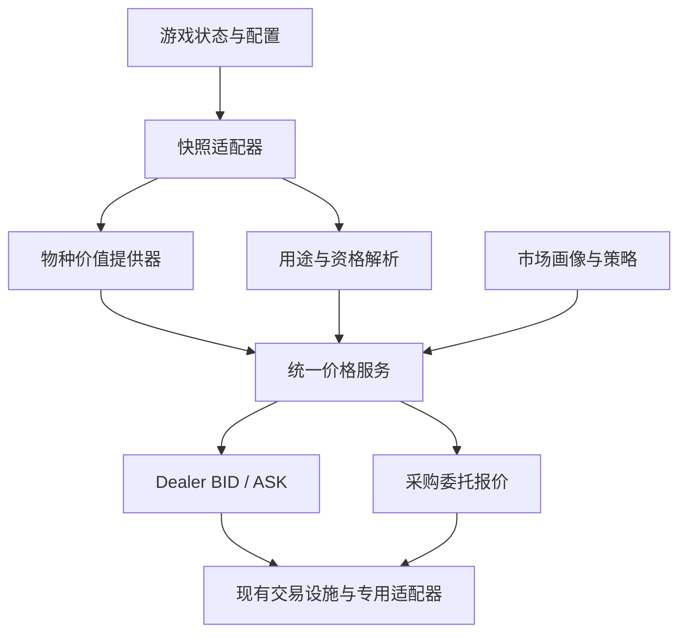

# FS25 F2M：畜牧商人 v2 与通用牲畜市场整合实施设计

日期：2026-10-22。用途：供数值策划与 Codex 实施、评审和分批验收。状态：文档整合与一致性审查；未改业务代码、未查询最新仓库、未运行经济模拟或实机测试。

本稿完整纳入两份方案的交易、身份、库存、报价、订单、恢复与开发拆分；总览只作为经济原则与历史依据。本文前部 A–L 是跨方案统一规则；附录一保留并修订市场框架的完整细节与 U01–U96；附录二整合商人 v2 的运行契约。冲突以 A–L 的明确修订为准。已有代码是否完成必须在实施时核对，不用文档日期推定。

## A. 审查结论与资料边界

**可以合为一套系统，但必须把实际动物库存、价值计算、交易执行与月度采购需求分开。** 商人 v2 负责“玩家买到哪头真实动物”；通用市场负责“不同渠道如何估值”；Broker 负责“当月哪些买家收什么、收多少”。共用身份、金额、只读快照、权限和交易证据，不另建第二套动物生理或 NPC 经济。

资料基线：

| 输入 | 用途 | 时效处理 |
|---|---|---|
| FS25_HB_RLRM_总览.md，2026-10-01 | HARD、游戏月、产肉不改价品质、HB 设施等背景原则 | dev.7、PR 状态、旧价格和旧公式均为历史；不作为当前参数 |
| 畜牧商人交易系统-v2：细化设计-v1.txt，2026-10-13/14 | 实际来源、统一身份、购买、日志、恢复、UI | 自带后续注记优先于旧“待确认”表；T1 本地提交是附件中的记录，未在本次独立核验 |
| FS25_通用牲畜市场框架_实施设计.md，2026-10-21 修订10 | 统一 BID/ASK、跨物种用途、有限月度订单、U 单元 | 所列 dev SHA 是该稿历史核对基线，不是本次最新远端事实 |

本轮仅审查提供的文本，因此不把其中引用的源代码、未提供的 T1–T6 分批文件或 Session 交接当作本轮已经读取的证据。施工前冻结 dev SHA、已合入单元、运行开关、配置及地图版本，逐项替换历史描述。

## B. 统一后的玩家玩法与系统范围

| 渠道 | 玩家行为 | 价格 | 对方库存/额度 | 确认粒度 |
|---|---|---|---|---|
| Dealer 购买 | 从商店买实际挂牌动物至已验证目的地 | 独立 ASK + 一次购买运费 | 真实私有来源与有限在售列表 | 整批确认，全部成功或整批拒绝 |
| 普通 Dealer 出售 | 按现有入口卖合规动物 | BID，额外费用沿实际渠道 | 不纳入 v2 购入库存，不耗 Broker 配额 | 保留现有渠道粒度与事务语义 |
| Broker 接运 | 在牧场预检、逐只卖给当月买家 | 目标估值 − 佣金/约束 − 接运费 | 全市场共享本单/物种/品种三层头数 | 每只单独确认 |
| Broker 自送 | 预检后装车，到活畜接收点复核 | 与接运同基准，接运费为0 | 与接运共用同一份额度 | 每只单独确认 |
| HB 合同加工/屠夫 | 交活畜、付加工费用、取得肉产出 | 保持已有加工与实际售肉流程 | 现有加工容量与准入 | 保持已有合同规则 |
| 精液/AI | 既有独立商品与繁殖用途 | 本期不另改定价 | 身份入口参与协调，商品渠道保持独立 | 既有方式 |

牛猪羊是市场框架的目标范围，**不等于商人 v2 首次同时开放牛猪羊**。Dealer v2 继续牛类先验收；Broker 可以按自身真实来源、估值、身份及保存能力逐物种上线。猪羊新版营养、奶绵羊、HB MILKCOW、山羊、马和其他动物均不能因装载统一框架自动获准。马不进入肉用清仓。

以下边界保留：无拍卖、玩家间新交易渠道、母子打包、新订货配送、动态供需价格、运输损耗、NPC 消耗公开配额。Broker 接运是出售即时移除与净额结算，不等于给 Dealer v2 新增购买配送系统。

## C. 需要修改的冲突与缺口

下表中的“修订”是本稿提出的实施规则；新增经济参数仍须扫描后确定。

| 项目 | 原文冲突/缺口 | 整合修订 | 性质 |
|---|---|---|---|
| C01 市场虚拟化 | 容易被解释成删除 v2 实际库存 | 虚拟的是下游流动性和需求；商店出售实际动物，来源继续真实推进 | 语义统一 |
| C02 新 ASK | v2 仍写有效旧买价；市场要废止 BID×markup | legacy 保持旧买价；market 的单只/批量/v2/自动管理员共用 ASK；额外 markup 不得重复乘 | 接线必改 |
| C03 舍入 | v2 按原精度，市场候选按0.01 | 保持现行结算精度；统一 MoneyPolicy。若采用货币量化，须所有新价格入口一起验证迁移，不能只让 Broker 四舍五入 | 接口必改 |
| C04 复验 | v2 生理游标变化使报价失效；Broker 容许同额微变 | 保留 v2 严格校验；Broker 按资格与全部结算明细复验。两渠道不得共用一个“忽略 revision”开关 | 安全边界 |
| C05 来源凭证 | “无购入记录”可能被误当自产 | 区分自产已证实、购入已记录、历史来源不明；未知不伪装自产，也不拒绝全部旧动物 | 账本必改 |
| C06 三套保存 | 重用交易代码不代表额度与资产共同保存 | Broker 定义自己的参与者与提交证据；与所用动物/资金/来源账本同代核验，不大统一旧 checkpoint | 恢复必改 |
| C07 跨渠道竞争 | 各自锁可能允许同一动物双卖 | 按完整身份键共用锁服务；接入普通卖出、Broker、屠宰、转移/阉割等真实竞争入口 | 接线必改 |
| C08 T/U 重复建设 | T2/T4 与 U65/U66/U75 职责相交 | 身份与持久层按能力复用；T 专注 Dealer 购入，U 专注价格与 Broker，建立完成证据映射 | 施工修订 |
| C09 有限订单 | 容易与 Dealer 的 pSale 或库存周转混用 | pSale 是估值概率，不抽真实售出事件；0.25月补货和0.5/1/2月周转仍由 v2 目录驱动 | 经济边界 |
| C10 路线套利 | ASK/BID价差和订单cap不能单独证明所有渠道无套利 | 增加实际购买→普通售出/订单/立即屠宰的费用完整扫描；异常组合不开放对应新价格 | 验收补充 |
| C11 品种分散 | cap鼓励多品种，但不保证随机市场每月匹配 | 保留随机、有限订单；12–36月衡量空窗和额度利用，不承诺规模大必定交满 | 目标澄清 |
| C12 参数状态 | v2 后续注记说 D1–D7 已采纳，旧表仍待确认 | 按附件后续注记登记“此前会话已采纳，实施核验”；不再次把全部 D 项挂起 | 状态修订 |
| C13 历史生理参数 | 总览的出栏月龄=HB下限、Swiss Brown兼用等旧叙述 | 当前用途分类按解析配置；屠宰准入与经济出栏点分开；不复活旧固定月龄或旧价格 | 基线修订 |
| C14 渐进依赖 | U50依赖全部条件包会卡住首个物种；G4末尾校准措辞不足以表达前置 | U单元按能力范围完成；上线前对应包可达性/经济扫描必过，其他物种可缺能力 | 任务图修订 |

## D. 单一职责、接口与能力门控



同一份配置/物种适配可以被两个运行时读取；只读使用 `dealerStock` 分类不启动 v2 补货。纯价格层不调用 `getSellPrice()`，不推进动物，不生成身份，不操作资金。生长、营养、疾病、繁殖、肉量仍归原模型。

门控分别存在：`dealerRuntimeReady`、`marketPricingReady(scope)`、`brokerPreviewReady(scope)`、`brokerSettlementReady(scope, transportMode)`。另有 singleplayer/multiplayer 与地图/容器作用域。关闭 Dealer v2 不必关闭所有订单预检；关闭新报价不删除库存、来源凭证、历史订单、未决锁或回执。

市场的 `legacy/shadow/market` 与 v2 的 `READY/RECOVERY_REQUIRED` 是不同维度。恢复有问题时停止受影响真实交易，不能用 legacy 回退绕开已存在的未决证据。某新品种缺 provider 可以走已验证旧价；发生资金/身份不明的同一动物不能借旧渠道继续卖。

## E. 身份、购入来源与跨渠道互斥

### E1. 三类身份不可混用

- 动物完整键固定为 `(farmId, uniqueId, country)`；其中 farmId 是出生 herd 身份，不是现 ownerFarmId，且不加入物种以掩盖碰撞。
- saleId/sourceId 管商品与来源；orderId 管需求；requestId 管一次调用及精确重试。显示耳标、列表序号和容器位置均不能替代动物键。
- 新身份分配只属于新动物/已固定胎儿入口；Broker 出售已存在动物不得重分配身份或重抽状态。跨农场转移保持动物键。

统一分配器的预留、烧号、非单射 `padId`、旧域迁移证明、出生失败挂起和未保存烧号规则，沿附录二完整约束。Broker 成交至少需要稳定且可唯一解析的身份及其有效性证据；若能独立证明该作用域安全，不要求整个 Dealer 商店 UI 先完成。不能只因“当前存活键不重复”就声称拥有跨历史分配证明。

### E2. 新增统一 AcquisitionReceipt 契约

```text
animalKey, originStatus, purchaseReceiptId, purchaseRequestId,
sellerChannel, buyerOwnerFarmId, acquiredAtAbsoluteMonths,
bodyAmount, mandatoryFees, totalPaid, currencyBasis,
difficultyAtPurchase, acquiredSnapshotDigest,
formula/config/priceRevision, savedCheckpointRef, provenanceChain
```

`originStatus = OWN_BIRTH_PROVEN / PURCHASE_RECORDED / LEGACY_UNKNOWN / QUARANTINED`。自产证明来自已有出生/来源记录，不额外改变正常出生算法；动物转栏、装车、改名及经营权改变不清除记录。玩家自己出生的后代拥有独立键和自产证据，不继承父母购买限价。

购入实际支出用**已发生的当时货币金额**记录，不随当前难度重新缩放；与新报价比较先转成同一当前结算货币单位。全部新 Dealer 买入路径必须产出等价凭证；旧路径不具备时不能宣称全面防套利。跨农场只传递原始来源证据，不自行虚构玩家间购买价。

历史来源不明的动物：保留既有合规普通出售；Broker 默认可预检，来源证明不足时按明确来源策略阻止依赖该证明的新成交。未来可以单独批准迁移基准/观察期政策，但不能运行时把空记录当自产或无成本购入。该策略是本轮新增建议，未假定已获得较弱迁移保证的授权。

短期倒卖限价的金额、时间窗、实质增重/阶段变化门槛、复合释放条件必须有配置与反例测试。不能仅因跨一步时钟、改名、换农场、stateRevision变化解除。等待多久才认可经济风险仍需校准，本稿不指定一个未经模拟的天数。难度切换也不能独自解除凭证约束。

### E3. 锁与幂等

所有服务使用同一个资源锁命名/排序协议，先枚举所需资源，再按全局稳定顺序获取，失败整笔退出；不能一个先锁动物、另一个先锁额度形成循环。资源包括完整动物键、经营农场资金、真实容器，以及 Broker 的旧月/当月物种、品种、订单池。只锁实际需要的资源，不给浏览或逐只确认框加全农场长期锁。

对尚未接入共同锁的旧入口，必须验证其在同步临界段不能重入，或禁用冲突入口；不能只在新服务里建锁便宣布跨渠道安全。阉割、移栏等状态变更可在事务开始前发生，进入临界段后须由共享栅栏保证不会改动待成交对象。

不同业务的 requestId 加业务命名空间和 serverEpoch，绑定 principal、规范载荷、凭证与目标。精确重试先查原终态，再校验能否发新交易；成功后动物已移除不应让原成功重试变成“动物不存在”。查询旧结果仍须鉴权。

## F. 统一价格与报价复验

### F1. 价值与报价关系

HARD 作为模型计算基准，kg/L 与游戏月保持统一。`S` 是同口径屠宰销售净收入估算；legacyFloor、旧繁育 price 都不是未折价原始价值。质量通过现有肉量体现，不再给肉每kg重复加价。DAIRY/TERMINAL/MATERNAL 各目标分别估值；多用途取可实现最大路径，不求和。

Dealer 的 `ASK` 从独立零售参考价值导出，`BID` 从立即商品转出/专业等待路径计算。quality preset 控制货源基因分布；可把既有 markup 迁移成显式 retailServiceFactor，但最多应用一次。市场模式下禁止在新 ASK 外再乘旧 markup，单只、批量、旧 UI、v2 Assembly 和 Herdsman 必须一起检查。

Broker 每只运输前净额取买家净估值、独立同状态 ASK 减价差、来源限价的最小值；FINISHED 再受 `S − max(绝对差额, S×比例)` 限制。所有奖励先计入后限价，再扣一次接运费。自送与接运同状态差额严格等于同一运费；成品cap不套种畜和架子畜。

### F2. MoneyPolicy 与金额快照

模型内部不舍入；适配器注明 HARD/CURRENT 及费用倍率。首次只冻结并保留引擎/既有支付的有效精度，不在文档阶段宣称游戏最小单位必为0.01。

若实施采用最小结算单位 `u`，须先验证该单位能被资金接口、网络、保存和回读一致表达，再统一量化：显示明细是量化后的实际结算项，到账由这些项求和；运输前上限朝收入减少方向量化，最后复核价差。原始实际购入收据不被回写修改。不得先把两种运输最终净额各自舍入而破坏运费差额。

正式凭证携带不可变 `MoneyBreakdown`、最终货币金额、费用basis、来源限价结果、公式/配置/价格版本。确认 UI 与付款消费同一个服务器结果，客户端不二次算价。版本变化不允许绕过原 v2 严格凭证检查。

### F3. 两类报价分别保留复验政策

| 项目 | Dealer v2购买 | Broker出售 |
|---|---|---|
| 有效期 | 15秒真实会话时间 | 15秒真实会话时间 |
| 报价是否占库存/额度 | 否 | 否 |
| 确认时预占 | 整批商品，沿用5秒预留窗口 | 单只身份及三层1头额度 |
| 生理游标/revision变化 | 沿现协议重报，不顺手放松 | 重读资格；全部金额/费用相同且仍合格可接受微变 |
| 资格/权限/位置变化 | 最终复验，不可默改目的地/数量 | 最终复验，越界拒绝，金额变化重新确认 |
| 预占超时 | 不覆盖已进入副作用阶段的证据 | 不释放未决动物锁或额度 |
| 重载 | 旧短时凭证失效；查持久成交回执 | 同左；旧月未决使用旧月额度 |

两类服务可以共用快照、MoneyPolicy 与凭证存储原语，但各自复验策略显式配置，不能把 Broker 的语义复验直接套进 v2 严格协议。

## G. 实际库存、生理时钟与虚拟市场

Dealer：真实来源按既有生理模块连续推进；候选计划及 RNG 固定，身份批量预留，Factory/OwnedAdmission 绑定凭据后挂牌。玩家卖给普通 Dealer 的动物不进入这份来源库存。退出挂牌不是死亡；退役/离场留身份与历史摘要。

沿 v2 方案：每0.25游戏月检查补缺；跨多次检查只按最终缺额补一次；未断奶/育成后备/繁殖生产商品的周转候选分别0.5/1/2月；撤回来源保留2月、活来源上限为在售目标容量3倍。以上按附件后续注记记为此前已采纳方案，精确实际配置及完成情况施工时核验，不覆盖当前已经批准的更具体目录值。隔离、已售与未结事务不按普通退役清理。

市场估值中的 `H`、`pSale` 与月持有成本只计算商人经济报价，不调度真实成交、不推进私有源、不创造未来幼畜，也不要求其等于某头挂牌动物的周转TTL。真实货源生产史和市场对未来生产的估值不同，不能由“冻结估值状态”误停真实库存生理。

Broker：月初按独立市场seed生成当前月；跳月不补造历史订单；不读玩家群或 Dealer 在售量。浏览、筛选、预检和报价均不消费任何生成/繁殖随机流。商品/订单生成候选先规范排序，确保 Lua 表遍历变化不改变结果。

全局调度协调来源更新、出生、交易和保存的临界区；长回放分帧，不让普通畜群被商店计算长时间阻塞。报价钟用服务器单调真实时间，生理/容量/来源观察期用绝对游戏月，季节用显式日历月份。

## H. 月度需求、分类与数值参数

保留全部最新玩法：基础牛1–2单、羊1–2单、猪1单，牛羊第二单候选概率各0.5；再固定追加2张随机 SPECIFIC 单，能力充足通常5–7单；总上限7，牛/羊/猪各最多3/3/2单，同物种最多覆盖两个用途组。

三用途组 GROWER/FINISHED/BREEDING。基础 GROWER 可ANY或SPECIFIC，额外单全SPECIFIC；FINISHED、所有繁育和后备包必须SPECIFIC。ANY只是不限制公开大类内具体品种，仍逐只检查能力与资格，不使用隐藏品种集合。DUAL须公开允许，Swiss Brown按已解析use沿用，不据旧描述改类。羊毛productivity不当奶量、母乳或产羔数基因。

| 物种 | 月公共cap候选 | 每品种cap候选 | 育成/成品单量候选 | 后备/繁殖母畜单量候选 | 普通种公/精英种公候选 |
|---|---:|---:|---:|---:|---:|
| 牛 | 8 | 4 | 4 / 4 | 2 | 1 / 1 |
| 羊 | 24 | 12 | 12 / 12 | 6 | 2 / 1 |
| 猪 | 32 | 16 | 16 / 16 | 6 | 1 / 1 |

头数固定，全市场共享，不按农场数量/存栏/天数扩大；额外单不增加物种或品种cap，无额外金额预算，无余量结转。全局capacityScale与各项配置在附录一保留；这些值是待校准候选，不能当已通过模拟的市场规模。

每单展示本单余量、物种余量、所选动物品种余量；未选动物的ANY订单只能显示“品种限额按所选动物计算”或展开各品种，不能展示一个虚构统一ANY品种余额。

**不添加保证月月能交的保底槽位。** 多养品种提高覆盖机会，SPECIFIC随机性仍会带来缺口；1/2/4品种、不同规模、12–36月模拟记录零可交月份比例、P95连续空窗、公共cap利用率、留养月数和净收益。若体验不达目标，优先调容量、轮换权重、条件包和单量，再另行评审是否需要非随机保底；本稿不偷偷恢复全覆盖。

年龄、重量、finish/BCS/fat class、遗传指数与单项下限沿附录一完整条件包。架子牛仍是55%–80%个体参考重且finish<65；成品要求独立规格和真实出栏能力。发布前用实际启用路径证明可达，不能拿未启用的猪羊新版模型作默认能力。经济出栏点与地图加工准入分开登记，二者交集不成立时报告渠道限制，不为订单强改生长曲线。

## I. 两种成交与恢复协议

### I1. Dealer购入

鉴权与幂等查询→整批资源锁/资格/容量/资金复验→持久PREPARED/APPLYING及回读屏障→整批源移出和目标加入并验证→一次扣款与资金证据→商品SOLD与购入来源收据→终态日志精确回读→返回COMMITTED。

普通失败整批拒绝。资金已证明APPLIED且对象归属完整时完成原成交，不因预留窗超时补偿。资金UNKNOWN或不能证明归属时暂停，不能以普通失败引导玩家换requestId再买，也不自动加钱退款。购入来源收据属于同笔成交证据，不能等下次UI打开再补。

### I2. Broker交付

鉴权与幂等查询→按全局顺序锁资源→重读资格/报价/真实位置及三层余量→原子预占1头并持久PREPARED/完整恢复证据→从真实容器移除且验证仅一只→一次净额付款并保存收据→三层预占转已提交→持久终态并回读→返回回执。

恢复证据须包括移除前完整可恢复动物、来源容器/队列及身份绑定。不能只存animalKey和金额，再声称能够恢复孕母或原队列。付费接运不必创建NPC车辆；自送必须在明确活畜接收点。不能把动物作为“失败补偿”重新随机生成。

确定未移除、未付款可释放；已移除但资金NOT_APPLIED时，只有精确恢复并逐项验证成功才可回滚释放。删除/付款不明保留锁和三层预占；已证实付款且交付完整则完成提交。不凭余额、超时或pcall猜测结果，不盲目补款/补动物。

### I3. 保存共同证据，不合并全部实现

Dealer沿附录二参与者；Broker新增自己的月订单/额度/回执、购入来源凭证及实际使用的动物、资金文件核验。共享分配器启用后，其账本与原生计数器纳入对应完整保存证明。旧Trade无需为了复用而整套改写；如修改其保存边界，单独提交回归。

各渠道可以有独立checkpoint协调器，但它们涉及同一游戏保存时，要引用可核验的同一个完整游戏保存代次与lineage，不能仅各自都叫generation=5就认为一致。参与者摘要构成无环引用，最终标记引用已完成集合；真实磁盘回读后才认定已保存。日志回读不是fsync/断电原子性保证。

保存前栅栏阻止新事务、来源更新和相关身份分配；已有事务完成终态或明确保留异常证据。新增异常渠道停止，不擅自阻止引擎正常保存现有畜群；不将缺证据保存点标成可恢复完整成交。

已保存终态吸收为历史结清回执，重载不重新付/扣款；动物之后死亡/转场、余额有其他收支不影响历史有效性。资金收据结清不能依据当前余额等于某笔debitAfter。

未保存退出采用最后完整游戏存档，不单独重放现金、动物或额度；可完整验证的未保存身份按既定烧号方案处理。旧月未决额度留在旧月账本，新月不能把它重新释放成新容量；不同月份拥有独立池。任何损坏/混代保留原始证据并停止相关新交易。

## J. 统一施工路线与现有任务映射

**先核验已完成代码，再补缺口；不重新实施有证据的T1或既有交易设施。** T编号表示Dealer运行项目，U编号表示市场/订单项目，不相加成102个全新任务。

| 交付包 | 复用/对应编号 | 完成结果 | 可开放内容 |
|---|---|---|---|
| P0 基线与职责冻结 | T1–T6状态审计；U01/U02 | SHA、配置、功能开关、已完证据及能力矩阵 | 不变更游戏报价 |
| P1 价格纯层 | U03–U32，按目标范围 | legacy/shadow、快照、provider、S/ASK/BID、MoneyPolicy | shadow比较 |
| P2 身份和交易基础 | T1/T2；U65/U68/U69共享接缝 | 稳定完整键、来源凭证协议、共同锁、保存/迁移证明 | 按已验证能力接线，仍不自动开放 |
| P3 Dealer实际库存 | T3 | 固定生成任务、真实来源、生理、撤回、补缺 | 只读挂牌 |
| P4 Dealer购买贯通 | T4/T5/T6；U33–U40/U66 | 单只/批量ASK、真实购买、购入凭证、保存后再买 | 已验牛类、地图/容器，单机先验 |
| P5 Broker只读 | U41–U64/U77–U79/U91–U93 | 合法条件包、月需求、额度查询、两方式报价、来源限价 | 只读预检，不交易 |
| P6 Broker接运 | U67–U80/U94/U95适用项 | 移除一只、付款、原子额度、恢复和逐只确认 | 对应范围接运 |
| P7 Broker自送 | U71/U81–U83及P6基础 | 接收点、拖车单只适配、到场复验 | 对应地图/拖车自送 |
| P8 扩物种与平衡 | U20–U24/U84–U90/U96适用项 | 对应生产估值、实际窗口、经济及联机结果 | 逐目标逐模式开放 |

P2的基础身份能力不是P1纯数学的前置；P4也不需要先写完全部Broker订单。Broker首批成交不要求Dealer v2购买UI先完成，但必须有等价身份、全部可用购入路径来源证据与保存证明，不能靠绕过P2/P4能力提前上线。

**依赖修订：** U50只依赖本次发布作用域实际使用的U44–U49，不强迫第一张牛架子订单等待泌乳奶羊；U51只证明对应包/品种/等级可达；U91在该范围U50后解析；U53/U54随后生成，不能反向依赖真实玩家畜群。U84–U86是最终参数校准，不得把上线前可达性校验U51延到最后。U87–U90按实际发布scope验证，单机与多人分别记录。某scope缺能力只剔该scope，不把全部其余目标标已完成。

第一包可沿原框架U01/U02/U09/U10/U11做协议与旧行为；同时对已有T1成果做只读状态核验。不要为整理文档创建新业务分支或合并PR。

## K. 合并前必须补的联合验收

| 类别 | 必须证明的行为 |
|---|---|
| 价格一致 | 单只、批量、v2、旧购买与自动管理员同一ASK；普通出售同一BID；无二次markup/难度倍率 |
| 无即时正循环 | 实际购买→普通卖、Broker、立即加工售肉，计入可实现费用/加成；仅满足BID<ASK不算全渠道通过 |
| 来源与难度 | 低价旧购入后当前涨价、切难度、转栏/跨农场/改名/微增重不能洗凭证；自产后代不继承封顶 |
| 报价 | v2严格版本校验保持；Broker同额微变可过，越界/费用变化须重新确认；TTL不释放未决锁 |
| 同一动物竞争 | Broker接运/自送/普通卖/屠宰/状态变更的真实入口不双成交；失败不伤批外动物 |
| 最后一个名额 | 不同动物争本单/物种/品种最后名额仅一个成功；余量尚足时无需因计数revision重报 |
| 保存恢复 | 多次购买、转场/产仔/死亡、收入、订单交付后保存重载再交易；资金与额度都不重放 |
| 故障注入 | 每次预占/移除/付款/日志写入前后失败，证据足够才能回滚或提交，UNKNOWN保持隔离 |
| 月界 | 月前已获准并持久prepared用旧月额度完成；旧凭证失效；跳月不补单；1/3/7天模式一致 |
| 身份 | 非单射编号、跨物种同域、固定胎儿、旧档未知/重复、未保存烧号按既定边界验证 |
| 规模与多品种 | 1/2/4品种及12–36月供需模拟，统计空窗和留养，容量不随玩家规模膨胀 |
| 能力矩阵 | 羊毛不冒充羊奶；MILKCOW/GOAT不套牛默认；猪羊新营养开关保持自身状态 |

S是参考站点与费用假设下的估算；PF个人加成、站点可达性和实际加工费未知时，不得用标准S宣称绝对无套利。静态检查先对明确basis验证，实机再对实际能走通的路线比对；真实无风险即时正循环属于新价格发布阻断项，而正常饲养、时间与市场风险收益允许存在。

## L. 状态、参数与实施记录

本轮不重新询问此前已采纳的D1–D7。按v2后续注记记录其既有采纳状态，落地前核验；旧历史保证不足时是否接受MIGRATION_POINT仍保持未获批准，不自行降级。

本轮新增待校准项：MoneyPolicy有效精度、来源限价观察期及实质变化、各scope实际S费用basis、跨渠道价差、候选月cap/单量的体验。现有权重/年龄/指数也仍需实际可达性和经济验证。可先实施legacy/shadow与纯服务，不因未校准价格阻塞所有准备工作；真实支付关卡不得绕过。

每个T/U任务记录 `scope / baseSHA / implementationSHA / configRevision / runtimeMode / map&gameVersion / verification / status / blocker`。状态至少区分：代码已有待核验、可复用已核验、需修改、待实现、缺能力、候选数值、实机待验。附件中的历史测试总数不能自动成为本次通过记录。

---

# 附录一：通用市场完整实施细则与96个最小可测单元

以下保留修订10的详细公式、协议、配置、条件包和任务编号，并直接修订上述明确冲突。所有源码SHA/远端核对措辞只表示原稿当时的记录。

## 市场细则阅读说明

原稿日期：2026-10-21；本次整合修订：2026-10-22。读者：数值策划与负责实施的 Codex。保留修订10玩法：基础3–5单加固定2单随机需求；集中平衡配置；按订单、物种及品种设置有限月度收购容量与事务化额度。

## 1. 结论与范围

采用 **统一动物快照 + 物种价值适配器 + 市场画像 + 可组合报价策略 + 现有交易设施**。Lua 中以模块/table 和显式接口实现，避免建立 Animal→Cattle→BeefCattle→BreedingBull 这样的继承链。

本方案落实附件中最后确定的方向：市场供需完全虚拟化；流动性使用预设曲线；普通 Dealer 承担转售风险；委托代表已有买家。市场画像不是品种类，也不是 Animal 的新子类。

本期搭建市场经济基础，不重写生长、营养、疾病、繁殖或屠宰产量。牛、猪、羊是首批业务范围。小型家畜以后复用接口；马保留现有独立逻辑，不加入肉用框架。总览中的 HARD 校准、每游戏月时间口径、质量通过出肉量体现、服务端结算等原则继续保留。

交付性质：实施设计；没有修改业务代码、提交 PR 或运行新框架。文中所有新增模块、接口及 XML 都是拟议设计。

### 1.1 本次合理性复审结论

保留已确定玩法：月度公开多需求；固定月度头数容量，不设额外货币预算；ANY仅限育成／架子类，且为公开大类内不限品种；逐只预检与确认；付费接运和自行送达；架子牛55%–80%参考重且育肥分<65；商品产肉复用既有模型。当前方案可进入框架施工，但下列修订必须一起实施，不能只做界面。

| 发现的问题 | 本次修正 | 对玩家的影响 |
|---|---|---|
| 成品活畜订单高价可能挤掉屠宰路线 | 成品活畜按批发渠道计价，全部奖励后的运输前净额仍低于同口径屠宰净收入，见10.2 | 保留方便出售出口，自营屠宰销售有额外收益 |
| 需求改为有限容量后，Dealer若引用公开订单可绕过数量限制 | 默认关闭Bbroker实际报价；公开订单是玩家直供渠道，Dealer使用独立下游市场，见7.2 | 不靠无限卖Dealer间接兑现有限订单高价 |
| 已有dairy/beef/dual又另建分类来源 | 优先读取dealerStock已解析use；市场只补缺失登记与能力，见10.5 | 瑞士褐牛等不因新系统换分类而意外失去出口 |
| 接近出栏与架子采购混用同一体重门槛 | 80%只是买家采购上界；出栏仍读现有95%及体况，80%–95%可继续饲养 | 超过架子上限不误报为可屠宰 |
| 很短的报价严格绑定不断变化的数值 | 复验真实资格与最终金额；无实质报价变化可维持原凭证，见10.9.2 | 不因正常微量增重反复被要求确认 |
| 示例字段、配置默认值、年龄和能力回退不完整 | 补协议、发布校验、数值校准与可行性报告 | 缺能力明确显示，避免上线出现空单或自动降标准 |

本次是设计一致性审查，未执行经济全量模拟或实机验收。新权重、概率和价格参数仍是候选值；本文的配置结构、阈值示例与算例不能被当作“已校准”的生产配置。

## 2. 审阅基线与代码事实

仓库现名为 [xtcg/FS25_RealisticLivestockF2M](https://github.com/xtcg/FS25_RealisticLivestockF2M)，以开发集成分支为准：

- `dev`：`c8b67ff9789fbb023982186fd9f7c4e43563f287`。
- `main`：`8b3224e320ca949346bff8eb549df91293f72f71`。
- 原稿记录已获取并读取该 dev 源码，不沿用10月1日总览中的dev.7状态；本次未独立重新获取。
- 检查时 #76–#79、#81–#84 是采精/精液及修复的堆叠 PR；#80 是指南；这些未合并分支不作为已实现依赖。后续实施前重新确认 HEAD。

### 2.1 已有能力与复用边界

以下路径均相对仓库根目录。

| 代码位置 | 当前行为 | 本方案处理 |
|---|---|---|
| `scripts/animal/RealisticLivestock_Animal.lua`：`getSellPrice/getCurvePrice` | 牛进入繁育估值；其他动物走曲线与肉用保底 | 保留兼容入口，逐步委托给统一价格服务 |
| `scripts/animal/RLBreedingValue.lua`：`covers/getQuote/combine` | 只覆盖 COW；输出 curve、meatRoute、standard、deltaOwn、deltaHered、score、price 等；已经含认可率、风险和价格上下限 | 先包成 legacy provider，再拆价值与渠道价格，不能直接把 price 叫作 V |
| `scripts/animal/RLMeatValue.lua`：`getSlaughterValue` | 计算肉值后扣费，再除以 `1+maxSlaughterMargin`，淘汰还乘 cullFloorFactor | 这是活畜价格保底口径，不是玩家实际屠宰净收入 S |
| `scripts/animal/RLMeatMath.lua` | 数据输入输出的产肉数学；`compute/check` | 原样复用，不用压出肉量来修交易价格 |
| `scripts/animal/RLBreedTraits.lua` | root→animalType→breed→subType 分层解析、解析值按更具体层覆盖 | 复用数值层解析；字符串策略、曲线和列表另写严格解析器 |
| `scripts/animal/RLSpecies.lua` | 服务营养配置选择；部分排除品种如山羊返回 nil，进 root 回退 | 不能不加检查就当作市场物种分类器 |
| `scripts/gui/rlmenu/services/RLAnimalBuyService.lua` | 原稿记录单头 ASK = getSellPrice × Dealer markup；批量函数内另写了同类计算 | 单头、批量同时接统一 ASK，防止只改一处 |
| `scripts/dealer/RLDealerQuote.lua` | 服务端短时报价凭证、版本检查、15 秒有效期、复核价格 | 保留协议语义，替换其适配器内的价格来源 |
| `scripts/dealer/RLDealerAssembly.lua` | 将报价、购入与游戏世界装配；价格可通过依赖注入传入 | 优先从此处接新 ASK，不重建 Dealer v2 |
| `scripts/animal/RLTradeTransaction.lua` | 交易状态机、资源锁、幂等与未决对账 | 复用设计和组件；委托交付仍需专用适配器与扩展 |
| `scripts/animal/RLSaleSettlement.lua` | 对 addMoney 的实际变更提供付款回执 | 复用，不能只凭函数返回认定付款成功 |
| `scripts/animal/RLContractTrade.lua` | HB 公共屠宰加工交付；初始支持 COW，OFF/SHADOW/TEST | 与“牲畜采购委托”是不同业务，不能直接改名复用 |
| `scripts/disease/RLDiseaseSaleGate.lua` | 有症状动物禁止销售/屠宰交付 | 所有新增渠道继续遵守；清仓不绕过禁售 |
| `scripts/dealer/RLDealerClock.lua`、`scripts/utils/RLCalendar.lua` | 游戏月推进及 period→日历月份投影 | 复用时间口径，不用真实分钟产生市场需求 |
| `scripts/dealer/RLDealerRuntime.lua` | Dealer v2 每次加载默认关闭，存在能力门控 | “代码存在”不等于默认游戏路径已启用，不擅自打开 |

源码定位：[动物价格](https://github.com/xtcg/FS25_RealisticLivestockF2M/blob/c8b67ff9789fbb023982186fd9f7c4e43563f287/scripts/animal/RealisticLivestock_Animal.lua#L1635)、[繁育估值](https://github.com/xtcg/FS25_RealisticLivestockF2M/blob/c8b67ff9789fbb023982186fd9f7c4e43563f287/scripts/animal/RLBreedingValue.lua)、[肉用保底](https://github.com/xtcg/FS25_RealisticLivestockF2M/blob/c8b67ff9789fbb023982186fd9f7c4e43563f287/scripts/animal/RLMeatValue.lua#L231)、[购买计价](https://github.com/xtcg/FS25_RealisticLivestockF2M/blob/c8b67ff9789fbb023982186fd9f7c4e43563f287/scripts/gui/rlmenu/services/RLAnimalBuyService.lua)。

### 2.2 对旧总览的关键修正

1. 当前已有羊、猪、生长和营养等大量后续实现，不能按“还没有这些系统”规划重建。
2. 当前繁育估值仅覆盖牛。跨物种可复用的是分解方式与接口，不是把牛的妊娠期、胎次、泌乳收益照搬给猪羊。
3. 当前 Dealer 已有货源、挂牌、身份和生命周期模块。新市场“不模拟库存”指**报价概率和委托生成不依据库存做供需反馈**。已有商店可购列表可以继续存在，无需删除它，也不新增 NPC 库存经济。
4. `docs/DEALER_V2_STATUS.md` 有历史分支/PR 状态和待实机说明；其历史合并状态不作为今日事实。当前启用情况以源码门控为准。

### 2.3 本次复核：产肉性价比已有基础，市场分类仍需新增

原稿2026-10-21记录通过GitHub确认 `dev` 为 `c8b67ff9789fbb023982186fd9f7c4e43563f287`，与本地检出一致。下表来自实际源码及随包XML，描述“有什么”，不声称完成了实机或全套数值再校准。

| 已有体系 | 已确认的实现 | 新订单如何使用 |
|---|---|---|
| 跨物种、品种产肉 | `RLMeatMath.compute()`、`carcassYield.xml` 按参考重、体型、体重完成度、carcassFactor、quality及体况计算肉量；牛／猪／羊有不同anchorWeight、胴体与可售比例、加工费 | 直接复用产肉结果及费用分解；订单不另加笼统“奶用肉值打折” |
| 品种肉用差异 | 牛HOLSTEIN carcassFactor=0.94、SWISS_BROWN=0.98、ANGUS/LIMOUSIN=1.06；各有maleMaturity。猪BERKSHIRE=1.08、BLACK_PIED=0.96；羊不同品种有不同出栏参考重及部分carcassFactor | 这是多个因子之一，不是“最终收益打94折／106折”，也不是现实胴体率；不能单看一个因子推利润 |
| 生长与耗料 | `breedTraits.xml` 有feed/growth/grass/hay/silage等品种参数；`RLGrowth`、`weightProfiles.xml`及营养预算提供生长／饲料机制 | 按运行时实际启用的路径读取成本和增长，不为订单复制另一套料肉比 |
| 肉价、成本与活畜关联 | `RLMeatValue`包含肉价季节传导、加工费、屠宰费和活畜保底；`RLMeatMath`可复用纯数学 | 仍须按第3章拆开slaughterNet和legacyFloor，不能把保底值当屠宰净收益 |
| 现有用途分类 | `dealerStock.xml`的COW品种use=dairy/beef/dual；`RLDealerStockPolicy.getEntry(config, subType, typeName)`解析use及繁殖体重等 | 优先转换为市场类别，不复制一份可能漂移的全品种分类表 |
| 牛乳用／肉用繁育 | `RLBreedingValue.getScore()` 与 `breedingValue.xml` 已有dairyShare、wDairy*、wTerminal*、wMaternal*；牛母畜的泌乳／子代现金流也有区分 | legacy模式保留；新订单按明确买家目标取对应分项，不能所有订单都用混合后的总分 |
| 既有离线验证工具 | `tests/economics.lua`读生长、食物与产肉代码；另有猪羊校准及feedbalance夹具 | 复用夹具做新市场扫描，旧脚本/历史通过数不代表新订单已验证 |

启用边界必须保留：随包 `weightProfiles.xml` 中牛根enabled=true；羊 `enabled=false,status=S5_CALIBRATION_OFF`，猪 `enabled=false,status=P4_CURVES_OFF`。猪羊新版营养/生长代码与参数存在，不等于默认游戏已启用；旧路径已有品种参数及产肉/经济规则。`RLBreedingValue.covers()`只覆盖COW，不能声称已有羊的完整繁育现金流估值。HB MILKCOW独立类型继续按能力门控。

遗传语义也已经核实：`genetics.quality`参与肉产出；`genetics.productivity`在牛乳输出中乘奶量，但在羊的WOOL/SHEEPWOOL_SHEARED等产出路径用于生产量。当前检查的本体羊与HB v1.5覆盖文件未提供绵羊乳输出；GOAT有GOATMILK，仍须分为GOAT物种，不能当奶绵羊。故不可因SHEEP存在productivity就宣称具备奶量或独立母乳遗传评价。

结论：**已有分物种、分品种的产肉经济基础，但没有一套已完成并默认启用的跨物种统一ROI函数，已有Dealer用途分类可复用，但没有完整的订单分类／能力协议。** 本次复用分类来源并新增订单匹配／指数／provider接口，不重建产肉体系，不另叠统一乳用品种惩罚。

源码复核入口：[carcassYield.xml](https://github.com/xtcg/FS25_RealisticLivestockF2M/blob/c8b67ff9789fbb023982186fd9f7c4e43563f287/xml/carcassYield.xml)、[breedingValue.xml](https://github.com/xtcg/FS25_RealisticLivestockF2M/blob/c8b67ff9789fbb023982186fd9f7c4e43563f287/xml/breedingValue.xml)、[RLBreedingValue.lua](https://github.com/xtcg/FS25_RealisticLivestockF2M/blob/c8b67ff9789fbb023982186fd9f7c4e43563f287/scripts/animal/RLBreedingValue.lua)、[weightProfiles.xml](https://github.com/xtcg/FS25_RealisticLivestockF2M/blob/c8b67ff9789fbb023982186fd9f7c4e43563f287/xml/weightProfiles.xml)、[输出逻辑](https://github.com/xtcg/FS25_RealisticLivestockF2M/blob/c8b67ff9789fbb023982186fd9f7c4e43563f287/scripts/animal/RealisticLivestock_Animal.lua)。

## 3. 必须先统一的价值语义

| 符号/字段 | 定义 | 不能等同于 |
|---|---|---|
| M / commodityValue | 当前状态下商品用途的参考价值，含架子畜未来育成用途 | 单纯当前肉重价格 |
| V / productionReference | 当前状态下生产/繁育用途的参考愿付价值；与 M 是替代用途 | 在 M 上再叠加一遍完整生产价值 |
| S / slaughterNet | 指定加工与销售假设下，玩家屠宰后的预计净收入 | `getSlaughterValue()` 当前返回值 |
| q / breedingScore | 某种用途的遗传综合评分 | 当前健康 health 或所有渠道统一品质分 |
| A / expectedResale | 指定用途按标准定价预期成功成交时的收入 | 新 BID 乘 markup |
| L / liquidationNet | Dealer 走商品清仓渠道可得的净回收 | 玩家自营终端零售 S |
| BID | Dealer 付给玩家的动物本体报价 | 玩家购买价 |
| ASK | 玩家向 Dealer 买动物的本体价 | BID 的固定倍数 |

统一数值协议：物理量用 kg、L；时间用游戏月；公式输入金额一律为 HARD 基准货币。价格适配器把引擎当前肉价先除以难度倍率；最终货币报价统一乘一次倍率。既有函数有的已经带难度倍率，legacy provider 必须先归一化，不能重复乘。

S是指定路线的估算，不能把“最高站点肉价”默认为每位玩家当下都可实现的收入；应使用配置明确的可达参考站点，不计未知个人加成。成品cap按同一basis比较，但不承诺未来肉价与实际最终利润。S 要返回 `basis`：销售站、价格快照、费用、产量、是否含 PF/站点加成。第一期使用可解释的标准站点价格；若拿不到实际个人加成，明确标记估算，不伪称最终到账。S 只供比较，不用修改肉的实际销售价。

### 3.1 金额、费用与显示的执行口径

内部计算使用未舍入HARD基准值，每一来源标注 `moneyBasis=HARD/CURRENT` 及难度倍率，不用猜测其是否已乘难度。外部当前价和运费在适配器归一化；最终统一应用一次难度倍率。运费仍以现有购买路径同口径结果为准，不默认跟其他成本作第二次缩放。

MoneyPolicy先冻结现行引擎/支付有效精度；0.01仅是待验证候选，不作为已确认的引擎最小单位。模型内部不舍入，确认金额及明细按整合规则F2的同一政策生成；订单净额由实际结算明细求得，UI展示不得二次改变价款。所有cap在同一基准和运输前应用；若启用经验证的货币量化，量化后再校验价差，不满足时按该单位向下调整收入项，并明确显示“价格约束调整”。同状态两运输方式净额差等于同一MoneyPolicy下的运费，非正净额只禁用对应方式。

难度切换不重抽订单，不改变基因条件；只重新生成两运输方式的有效货币报价。月初锁定的价格/规则模型仍生效，不能借难度切换刷新高价订单。

## 4. 总体结构



依赖只能由游戏适配层流向数据与纯计算层。纯计算层不读 `g_currentMission`、不操作 GUI、不抽随机数、不调用 Animal:getSellPrice。

### 4.1 拟议模块

放到 `scripts/market/`；既有模块只做必要接线。

| 模块 | 职责 | 复用方式 |
|---|---|---|
| `RLMarketSnapshot` | 从真实动物生成不可变报价输入、身份与状态指纹 | 一份协议，各物种共用 |
| `RLMarketConfig` | 加载、校验、解析画像/曲线/策略，生成 configRevision | 数值复用 RLBreedTraits；结构解析集中维护 |
| `RLMarketCurve` | 确定性分段线性插值、端点夹取 | 流动性、季节、阶段权重共用 |
| `RLAnimalValueProvider` | 注册 provider、能力声明、返回标准 ValueBreakdown | 组合接口，不存动物状态 |
| `RLMarketPurposeResolver` | 判定可进入的用途和禁入原因 | 规则依赖阶段、性别、资格；物种配置阈值 |
| `RLMarketMath` | 生存概率、期望持有时间、预期回收等纯公式 | 不按物种复制 |
| `RLMarketPriceService` | 编排 value→候选用途→各策略→输出明细 | 唯一渠道价格入口 |
| `RLDealerPricePolicy` | 商品立即转出、等待专业买家、独立 ASK | 所有物种共用 |
| `RLBrokerPricePolicy` | 已确定买家的单只估值、佣金、单只价格约束 | 不乘 pSale |
| `RLMarketGameAdapter` | 引擎价格、服务端接线、旧 API 兼容、缓存失效 | 业务模块不感知游戏全局 |

第一阶段暂不新建合同任务模块。完成报价校准后再增加 `RLBrokerDemand`、`RLBrokerOrderService`、`RLBrokerDeliveryAdapter`、`RLBrokerPersistence`；使用 Broker 名称，避免与 HB contract 加工路径混淆。

不是每个模块都必须有运行时实例：纯数学与策略可用无状态 table。只有保存订单、报价凭证或配置版本的服务才持有状态。

## 5. 统一数据协议与基础接口

### 5.1 AnimalSnapshot

以下为接口示意，不是现有字段的直接镜像：

```lua
snapshot = {
  schemaVersion = 1,
  identityKey = "authoritative-full-key", stateRevision = "fingerprint",
  animalType = "SHEEP", speciesKey = "SHEEP", breed = "TEXEL",
  subTypeName = "...", productionClass = "BEEF",
  supportedBreedingRoles = {"TERMINAL", "MATERNAL"},
  traitCapabilities = {meatQuality = true, milkProductivity = false},
  classRevision = "...", gender = "male", ageMonths = 7.2,
  weightKg = 47, targetWeightKg = 110,
  genes = {quality = 1.2, fertility = 1, health = 1, productivity = 1},
  health = 100, castrated = false,
  reproductive = {pregnant = false, lactating = false, parity = 0},
  production = {stage = "FINISHING",
    slaughterReferenceKg = 50, finishScore = 60, bcs = nil, fatClass = "3L"},
  eligibility = {tradeAllowed = true, breedingAllowed = true},
}
```

production各值由适配器映射实际能力；finishScore为0–100，bcs为1–5，fatClass为枚举，不能混作一个bodyCondition数值。示例仅说明协议形状，缺失为nil并带capability=false，不能用示例值补齐；阶段也须来自现有能力/配置，不能只看年龄。类别和trait映射版本随报价绑定；`stateRevision` 至少覆盖年龄、体重、所有相关基因、当前健康、疾病状态及严重度、妊娠/泌乳/胎次、阉割、体况、子类型。不要只以疾病个数判定疾病变化。

市场 `speciesKey` 独立映射：SHEEP 类型中的山羊必须明确映射 GOAT 或不支持，不得因营养配置回退成牛。HB MILKCOW 也必须显式能力声明。物种映射集中在适配器，所有策略不再解析子类型名称。

### 5.2 ValueProvider：可复用的“基础类”契约

```lua
provider.supports(snapshot, context) --> boolean, reason
provider.evaluate(snapshot, context) --> ValueBreakdown
-- context含明确的breedingObjective；乳用、终端肉用、母系分别估值，不使用统一综合分。
provider.breedingEligibility(snapshot, context) --> result
provider.holdingCost(snapshot, context) --> MonthlyCostBreakdown
```

```lua
ValueBreakdown = {
  schemaVersion = 1, providerId = "cattleLegacy", providerVersion = 1,
  commodityValue = 0, productionReference = nil,
  slaughter = {available = false, net = nil, meatKg = nil,
               gross = nil, fees = nil, basis = {}},
  breeding = {byObjective = {
    -- DAIRY/TERMINAL/MATERNAL仅在对应能力就绪时填入。
    -- [objectiveId] = {selectionIndex, valuationScore, referenceValue,
    --                  ownDelta, hereditaryDelta, eligible, reasons}
  }},
  capabilities = {commodity = true, breeding = false, slaughter = false},
  legacy = {bid = 0, ask = 0},
}
```

禁止用 `productionReference=0` 混淆“真实无生产价值”和“尚未实现”；未实现为 nil + capability=false。commodityValue=0也不代表可成交，legacy={0,0}只是示意，实际legacy模式必须返回冻结的原报价。专业报价需要的能力缺失时，跳过该用途并记录原因；不要伪造默认牛参数。

第一期 provider 可以在内部调用现有适配代码。后续再把生产现金流计算变为显式输入的纯函数；不要求为了架构先重写所有旧模型。

### 5.3 QuoteContext 与 MarketQuote

Context：`allowedProductionClasses`、`breedingObjective`、`classRevision`、`traitMappingRevision`、`calendarMonth`、绝对游戏月、`marketEpoch`、`configRevision`、`formulaVersion`、`priceRevision`、`difficultyMultiplier`、报价渠道、指定费用/站点假设。随机种子不属于普通报价输入。

MarketQuote：`status`、`eligibilityFingerprint`、`settlementFingerprint`、`channel`、身份/状态指纹、上述版本、`bodyAmount`、`fees`、`bonuses`、`netToPlayer`、`expiresAt`、被选用途、所有候选路径的明细和拒绝原因。可成交时`bodyAmount`须大于零，结算方向由渠道声明，避免买入支出被写成收入。

值计算、市场报价、服务端凭证分成三层：数学结果不带权限；价格服务给可解释报价；现有 RLDealerQuote 等机制负责身份、权限和短时凭证。不要把 15 秒 Dealer 购入凭证当作跨月合同。

## 6. 用途模型：一头动物可有多条可选路线

配置六个可共享市场画像：`youngStock`、`storeStock`、`finishedStock`、`breedingFemale`、`breedingMale`、`cullStock`。其中breedingFemale与breedingMale均通过乳用／终端肉用／母系子画像区分生产与遗传价值；公畜乳用价值来自女儿的预期生产，不能要求公畜自己产奶。

用途不是互斥单标签。例如合格种公牛同时保留商品渠道和种用渠道。解析器返回合格候选集合；Dealer 对不同经营路径取最大净回收，不把各条用途价值求和。

资格至少检查：性别、阉割、繁殖年龄/有效期限、现实已实现的体重门槛、繁殖能力和禁售规则。基因 fertility=0 的不育与一次未受孕不是一回事。淘汰母畜按资格退回商品渠道，不能仅凭“年龄超过某个硬编码牛月龄”。

推荐阶段顺序：禁售检查→能力检查→商品阶段→繁育资格→生成候选用途。生产阶段阈值使用物种配置或已有阶段系统；避免 cow/ram/boar 字符串判断散布各文件。

## 7. Dealer 数学：统一公式，不依赖真实库存

### 7.1 持有期与流动性

第一期持有期限 H 为非负整数游戏月，限定合理最大值；H=0 仅做立即转出。每月末尝试成交，成交当月承担一整月持有费。

固定概率：

`pH = 1 - (1 - pm)^H`

`E[T] = Σ(k=0..H-1) (1-pm)^k`，pm>0 时也等于 pH/pm，pm=0 时为 H。

一般情形逐月用当前日历月起逐月推进（k=1对应当前月）的季节曲线求pk；sk 为到第 k 月末仍未成交的概率：

`s0=1; wk=s(k-1)*pk; sk=s(k-1)*(1-pk)`

`expectedRevenue = Σ wk*Ak + sH*LH`

`expectedHoldingCost = Σ s(k-1)*Ck`

由此 `expectedRevenue` 和 `expectedHoldingCost` 是同一成交时点假设下的期望，不能一个按期望持有月数、另一个再收满 H 个月风险费。

pm 来自用途流动性曲线 × 日历月份系数，夹到 [0,1]。q 直接采用 provider 的基因评分尺度；现有牛评分约在 0.25–1.75，不把附件中的 90 分直接传入。若 UI 显示 0–100，在适配层作唯一转换。

第一期 Ak=A、LH=Lnow：冻结动物状态和标准价格，不在报价中让 NPC 真正育肥、怀孕或产奶。H 是经济等待期；需要“等待后更老导致清仓下降”时，另加可校准的残值曲线，不推进真实 Animal，不创建未来幼畜，不调用繁殖 RNG。

### 7.2 BID

`Bcommodity = Lnow - tradeCostCommodity - profitCommodity`

`Bspecialist = expectedRevenue - expectedHoldingCost - tradeCostSpecialist - profitSpecialist`

`BIDraw = max(0, Bcommodity, 各合格专业等待路线Bspecialist)`

本次需求改为有限容量，旧“订单无限收购→Dealer确定能立即转售”的假设不再成立。第一期 `publishedOrderInformDealerBid=false`：公开订单只向玩家农场直供开放，Dealer不作为合格交付主体；Dealer的pSale描述独立下游市场，不保证能使用玩家公开订单。因此实际BID不使用Bbroker，不创建NPC采购与虚拟消耗，不让玩家反复卖Dealer间接绕过订单额度。

Bbroker保留为shadow诊断候选：只能比较“若有可用额度的立即路径值”，不得影响实际报价。未来若需要启用，必须先让Dealer实际采购与公开额度原子占用/扣减，并明示其会消耗市场名额；不能仅把配置改为true就启用。第一期配置校验拒绝true，不在本方案中实现这套NPC履约经济。

计算依赖仍为参考价值→独立ASK→订单估值，不允许订单反调BID；Dealer普通公式可独立运行。配额变化只影响订单可交资格与shadow诊断，不把订单收满后的BID变化伪装成全市场崩盘。

商品清仓 L 的成本边界必须固定：若定义为“已扣屠宰与加工的 Dealer 净回收”，tradeCost 只收尚未扣的运输/中介费用。疾病折价先在价值层处理一次，市场层只处理持有期的新增风险，不能重复扣相同风险。

不要再次用旧 `meatRoute` 把新 BID 抬回原保底，否则 Dealer 风险折价可能全部被覆盖。旧 maxSlaughterMargin 属于旧报价规则，只在 legacy 模式保留；新模式用明确 L 与 BID/ASK 约束校准。

### 7.3 ASK 与 A 独立

`retailBase = max(commodityRetail, eligibleProductionRetail)`

`A = retailBase * expectedNegotiationFactor`

`ASK = retailBase * retailServiceFactor + retailFixedFee`

二者由同一个参考价值导出，不互相调用 BID。现有 Dealer quality preset 仍决定商店遗传分布；其 markup 可以作为过渡 retailServiceFactor，但其旧含义“乘 BID”必须废止。不能再把所有遗传等级差异都重复加到服务费。

最终要求同状态同快照 `0 <= BID <= max(0, ASK - max(minSpreadAbs, ASK*minSpreadRate))`。ASK不足以覆盖最小绝对价差时BID可以为0，明确显示零价／不可报价；不得返回负数。若 raw 超限，输出 `SPREAD_CAP_APPLIED` 并在扫描报告列出；频繁触发说明参数有冲突，不能静默把上限当主公式。

### 7.4 数值核对示例

示例只用于验证算式，不是建议最终售价：A=3650，pm=0.10，H=3，LH=1800，每月持有成本65，交易费95，利润130。

- pH=0.271，E[T]=2.71。
- 预期收入=0.271×3650+0.729×1800=2301.35。
- 持有费=2.71×65=176.15。
- 专业路线 BID=2301.35−176.15−95−130=1900.20。
- 最终还要与商品立即转出、可解释的专业等待路线比较，再校验独立ASK的价差。本算例假设没有可用公开买家。

## 8. 持有成本与跨物种生产价值

第一期 `holdingCostModel=fixedMonthlyCurve`：按物种、用途、体重阶段配置月成本，返回 feed/care/risk/finance 明细。它是Dealer虚拟成本，不会真的扣玩家饲料或钱。第一期risk只表示尚未包含的持有费用准备；若后续引入死亡概率，需同时改写预期收入和费用，不得既扣死亡损失又把收入全额保留。这样框架可先校准，不依赖完整的未来饲喂模拟。

后续可增加 `feedAndCareEstimate`：读取现有饲料需求预测和统一饲料参考价；使用游戏经济尺度，不突然以现实采食量替换已压缩的游戏饲料。模型选择由配置 ID 完成，公式仍集中维护。

| 情况 | 通用部分 | 必须保留的物种差异 |
|---|---|---|
| 肉牛、肉猪、肉羊 | 商品价值、流动性、持有成本、BID/ASK、屠宰比较 | 生产阶段、目标重量、屠宰费用与市场参考值；来源品种大类与商品用途分开 |
| 奶牛/乳用母畜 | 有限生产现金流、退出风险、折现结构 | 泌乳曲线、产出渠道、胎次和产后等待 |
| 种母猪 | 母畜价值 provider 接口、子代价值累计 | 胎数、产窝频率、淘汰胎次、仔猪净值；不使用牛奶模型 |
| 母羊 | 同一现金流累加工具 | 配种季节、产羔率、羔羊净值、羊毛；羊奶仅在支持时启用 |
| 种公畜 | 资格、有效使用期、后代经济增益 | 服务母畜数量、自然配种/AI 替代程度、权重和季节 |
| 山羊/小型家畜 | 同一 provider 与渠道接口 | 显式注册能力；未支持时保持旧逻辑 |
| 马 | 可复用报价基础协议 | 继续使用独立价值来源，本期不接肉用清仓 |

推进顺序：先 CattleLegacy 保持旧值，再 CattleReference 明确拆分；猪羊先接 commodity provider，繁育能力未实现时明确关闭，随后分别补 PigProduction/SheepProduction。配置加品种不等于自动拥有未实现的生产模型。

现有 `RLBreedingValue` 的 alpha/rho/E(q) 中混有“价值认可”及置信度。迁移时逐项分类：生产真实性折减继续留在参考价值，渠道变现难度移到市场层。不能把已压过一次的 legacy price 再当原始繁育 V 乘低流动性，否则高基因动物会被重复折价。

## 9. 配置协议

建议一个 `xml/livestockMarket.xml`，包含 defaults、曲线、画像、匹配规则和策略参数。用户覆盖位置沿用内部 mod ID：`modSettings/FS25_RealisticLivestockRM/livestockMarket.xml`。第一版沿用“整份文件替换”，避免再引入隐式跨文件深合并。

```xml
<!-- 拟议接口：示例数值仅供结构说明 -->
<livestockMarket schemaVersion="1" mode="legacy">
  <defaults minSpreadRate="0.04" maxHoldingMonths="12"/>
  <curves>
    <curve id="sireLiquidity" axis="breedingScore" interpolation="linear">
      <point x="1.00" value="0.03"/>
      <point x="1.30" value="0.07"/>
      <point x="1.50" value="0.10"/>
      <point x="1.75" value="0.06"/>
    </curve>
    <curve id="flatSeason" axis="calendarMonth" interpolation="linear">
      <point x="1" value="1"/><point x="12" value="1"/>
    </curve>
  </curves>
  <profiles>
    <profile id="breedingMale" holdingMonths="3"
             liquidityCurve="sireLiquidity" seasonCurve="flatSeason"
             costModel="fixedMonthlyCurve" resaleModel="productionRetail"
             fallbackModel="commodityWholesale" profitModel="fixedPlusRate"
             monthlyCost="65" tradeCost="95" fixedProfit="130"/>
  </profiles>
  <rules>
    <rule id="cattleSire" priority="100" animalType="COW"
          purpose="BREEDING_MALE" profile="breedingMale"/>
  </rules>
</livestockMarket>
```

解析规则：标量按 default→type→breed→subType 覆盖；市场画像按 ID 引用；匹配规则允许多用途，按 priority 及 specificity 决定同用途唯一画像，同优先级歧义报错。曲线整条覆盖，不逐点拼接。季节必须 12 月定义完整或显式引用完整模板；不靠数组第一个位置推断三月。

校验必须包括 NaN/Inf、pm 范围、H 整数边界、曲线 x 严格递增、画像引用存在、策略 ID 在白名单、佣金/折扣合理范围、费用非负、版本支持。`parseLayers` 只能解析非负浮点属性，不能直接承担字符串与曲线 schema。

本XML只是Dealer核心结构示例，并非完整可运行配置；不能复制后就开启订单。订单部分的发布清单至少还需：公开大类/目标与来源映射、完整条件包、按物种的最低kg、单只估值provider、佣金与运费口径、成品差额绝对/比例参数、最小零售价差、来源检查配置、接收点能力。缺失时对应功能保持legacy/shadow，不静默填牛默认值。不同年龄、性别、怀孕/泌乳包的例子必须由配置测试加载验证后才能发布。

配置只能选择登记的公式 ID，不加载 XML 里的 Lua 表达式。新增公式写成独立策略并注册，不在每个物种分支添加匿名公式。配置热重载先完整校验再整体替换；失败保持上一份有效配置。

## 10. 委托订单的基础设计

### 10.1 需求与订单

每游戏月开始一次性生成**当月公开需求池**，包含多个不同采购需求，不是“每月只有一单”。使用已保存的市场 seed 与月份组成稳定键，独立 RNG 流，不消耗繁殖/商店生成 RNG。多农场共享同一需求列表及有限的月度市场容量；第一期使用market-wide池，不随农场数量复制。列表和预检明确显示公共余量，联机玩家可能共同消耗。

不读取玩家现有动物，也不读取 Dealer 库存来决定生成何种合同。模板定义物种、用途、品种限制模式、年龄/体重/评分条件、月份、等级权重、期限、佣金和单只估值规则。流动性与合同频率共享季节模板，但不把 pSale 数值直接当订单生成概率。

订单不要求提前接取，逐只确认结算；收购数量受“本订单余量、该物种月余量、该物种本品种月余量”三道上限共同限制。额度在月初固定，不随玩家存栏、出生、买入或本月成交量扩张。满额不再接收，不降低已发布单价、不临时抬高门槛。未完成无罚款，未用整数名额不结转，不保证收走全部养殖产出；多余动物可继续养殖、等下月、普通Dealer出售或在达标后屠宰。

最低持久状态增加quantityTotal、各层已提交/事务预占数、绝对月份、额度版本、上一月已发布品种历史及结算回执。订单生命周期OPEN→FILLED/EXPIRED；共享物种/品种池耗尽时用独立capacityStatus=BLOCKED，不混淆为订单本身头数已满；月底统一到期。只生成当前月，同月读档不刷新额度。付费接运和自送共用同一额度，不设另一份运输方式配额。

### 10.2 报价与防即时倒卖

已确定买家，支付不乘流动性：

`candidateBeforeTransport = buyerUnitValue - brokerFee + allBonuses`

`cap = sameStateDealerAsk - minRetailDiscount`

`netBeforeTransport = min(candidateBeforeTransport, cap)`

`finishedCap = slaughterNet - max(finishedMarginAbs, slaughterNet * finishedMarginRate)`

`netBeforeTransport = min(netBeforeTransport, finishedCap)`（仅成品商品订单）

`totalNet = netBeforeTransport - sellerDeliveryFee`

**成品活畜订单必须保留屠宰渠道差额。** 成品买家按批发路线计价，不是把玩家完整终端肉收入直接发成活畜收购价。finishedMarginRate初始候选0.10，finishedMarginAbs按物种校准；取二者较大值，禁止相加重复扣。所有品质奖金、补助、品种专项溢价先计入候选，再应用finishedCap，不能在cap之后额外返还。屠宰净收入S已经扣加工、屠宰及约定销售费用，订单不再假装实际收取一次屠宰加工费；差额在页面标为“批发渠道折让”。S必须与同一动物、同一价格快照、同一HARD基准及约定费用假设对应。

例如S=£1,500、10%差额且绝对差额不超过£150，成品订单运输前净额最高£1,350；接运再扣运费，自送不扣接运费。这里£150是玩家继续承担加工销售工作的收益空间，是否足够还须静态扫描运输、时间和资源成本。S不可用、动物未满足本成品包所需屠宰年龄/能力或结果非正时，该成品报价不可用，不拿未知S=0硬算，不关闭其普通Dealer渠道。商品育成/架子订单和真正种畜订单不使用本成品cap，以免把活体未来生产价值压到当前肉值。

单只价格及来源防套利约束先应用于运输前净额，再按实际交付方式扣一次运费；不得先扣运费后再限价，以免两方式都触顶时抹掉自行运输的收益。最终净额非正数时显示原因并禁用本次出售，不静默当作零价成交。

sameStateDealerAsk必须使用与本只订单相同的参考价值范围：包括该动物已支持的所有合法生产目标，而不是只拿商品用途的低ASK压低乳用种公；ASK仍独立于BID与订单价格。若订单认可目标缺失相应独立ASK能力，先补provider，不用返回0的假想ASK做cap。

同状态 ASK 使用统一参考策略作“假想零售报价”，不需要 Dealer 真持有这头动物。第一版取消整单奖金，只允许单只价格内的连续品质加成；任何加成与补助均须纳入 cap。按只结算不扣屠宰加工费：玩家出售的是活体，不是委托加工。

月初发布时锁定：单只估值规则、佣金、公式/配置快照、条件、品种范围、期限、计价方式、三层头数容量。个体价由“本月规则 + 交付时真实状态”求出，逐只确认前显示最终净额。预览不预留采购名额；短时报价凭证只绑定本只动物和本次确认，防止重复出售。预览不预留额度；确认事务中才原子预占1只。单只价格约束与本月头数额度分开，后者按10.5.F执行。

**本月锁定规则，不承诺同一只动物整月锁定价格。** 价格输入策略须在月初发布时明示：第一期使用 `priceBasis=CURRENT_MARKET`，buyerUnitValue、成品S与独立假想ASK均从同一个服务端当前价格快照读取；固定报价公式、权重、佣金比例和渠道差额参数仍取本月规则。实际购入支出另由来源账本记录，不用当前假想ASK代替已发生支出；历史支出保持当时实际货币额，不因当前难度变更重算。月内市场价格正常变化可使两种预估金额变化，页面需显示“按当前状态与市场价预估”；正式15秒确认仍按10.9.2复验。这避免同时宣称锁定月价又在cap中使用变动肉价的冲突。若未来采用月初固定价格，须新增显式priceBasis，不在同一订单中隐式混用。

**月内配置刷新不得追溯改变已发布需求的规则。** 但个体年龄、体重、健康或状态变化会影响其资格和报价；确认凭证失效就重新展示，不能悄悄按另一金额成交。月度规则以快照保存，报价时的市场价依据也随凭证绑定。

为了阻断低价购入后在同一确定订单中立即交付，交易层另检查已记录的 Dealer 购入成本与来源：短期内且动物有效状态未改变时，全部净到账不得超过该购入实际支出减最小价差。这条检查不影响有自产证据的动物；来源不明不等于自产。来源状态、历史购入凭证及实质变化政策按整合规则E2，不抹去真实育肥、繁育、等待与价格风险带来的利润。阈值与“有效改变”必须配置并显示；微量增重、改名、转栏、跨农场转让、仅等一个计时步不能自动抹掉来源凭证。第一期不承诺完整识别所有真实饲养收益；先登记原始实际支出、购入绝对游戏时间、快照与价款，按配置的有实质变化条件评审，而非以stateRevision是否不同判断。购入成本约束对运输前净额施加同一上限，确保两交付方式差额仍等于接运费。自产后代拥有独立身份，不继承父母的购入成本封顶。来源适配缺失时，只读预览可用，但有跨快照套利风险的订单成交不能以“已防套利”名义默认启用，须在M7验收前补齐或保持shadow。

上述“同状态同快照cap”仅能在所有Dealer购入路径同价且费用齐全时保证即时倒卖不盈利；跨快照旧合同与新低价库存的完全防护，要等来源凭证和交易账本接通后才能验收。

### 10.3 交付与结算

服务器重读身份、所有权、权限、禁售、条件和额度；按整合规则E3全局资源排序锁住所需资金/容器、月度物种池、品种池、本订单及动物identity，原子检查并预占1个交付名额→持久化prepared→移除本只并验证→付款并保存回执→把预占转为已交付。确认前只读预检不占额，取消确认框不扣额。

若确定未删除、未付款，可可靠回滚释放预占；已删除但资金明确未应用时，须按持久保存的原动物/容器证据精确恢复并验证后才释放；删除/付款结果不明则保留动物锁及相关额度预占进入对账，不凭TTL释放。重试同requestId返同一回执，不能再扣一次名额。其他动物成交改变额度计数但不改变订单规则版本；只在剩余仍足够时允许本只继续成交，不因任意capacityRevision变化一律重报。

可复用 RLTradeTransaction 的资源锁与状态机思路、RLSaleSettlement 的付款观察。现有 begin 只认 CONTRACT/SALE，HB CONTRACT 又有目标加工语义；新增 Broker 业务需显式扩展 schema/执行器或由专用协调器组合公共原语，不把采购冒充为 HB CONTRACT。

原稿记录已有多个checkpoint系统尚未统一；本期不顺带大统一。Broker持久化要与实际动物、资金、购入来源凭证及交易回执具有可核对的共同完整保存代次与lineage，独立计数同号不足以证明一致，保存失败时关闭新交付并保留证据。正常游戏未保存的会话退出仍按整体游戏存档回滚，不单独重放现金。

### 10.4 现实依据与游戏简化

现实资料用于决定“买家为什么要这类动物、主要挑什么”，不把现实行业评级直接等同于游戏基因：

- [Teagasc：购买种公羊](https://teagasc.ie/animals/sheep/breeding-genetics/uro-stars-buying-a-ram/)建议先检查身体适用性，再选择符合改良目标的遗传评价。因此种公订单必须同时检查体况、健康、繁殖能力和遗传门槛。
- [AHDB：后备肉牛母畜](https://ahdb.org.uk/knowledge-library/managing-beef-replacement-heifers)强调繁殖力、营养、体重目标和遗传选择。因此后备母畜不能只检查母性别或高产基因。
- [AHDB：后备母羔选择](https://ahdb.org.uk/knowledge-library/selecting-ewe-lambs-for-breeding)指出年龄与体重都会影响配种适用性，并建议在配种前提前购入。游戏把羊的补栏需求集中到夏末至秋季；这是一种典型春季产羔经营节奏的简化，不是所有羊种/农场的通用日历。
- [AHDB：羔羊营销与选择](https://ahdb.org.uk/knowledge-library/prime-lamb-marketing-selection-and-classification)强调体重与脂肪覆盖都重要。因此成品订单设体重和育肥窗口，而不是越重越好。
- [AHDB：后备母猪管理](https://ahdb.org.uk/knowledge-library/gilt-management)强调后备母猪对猪群生产与更新的重要性。游戏把猪的补栏采购设为全年相对稳定，不模拟完整商业猪场生产批次。

以下概率、订单条目数、评分和年龄均为**待校准的游戏参数**，不是现实市场统计或现实交易强制标准。真实精液检测、蹄腿检查、检疫证明等没有现成数据时，不凭空用一个基因代替，也不因此新增复杂兽医系统。

### 10.5 月度生成与固定市场容量：基础单加两单随机需求

所有订单在当前月第一时刻发布，到下月第一时刻结束，时间区间为 `[monthStart, nextMonthStart)`。每月1天和每月28天模式下，发布条目数一致，订单条目与头数容量均不按每月天数放大。条数决定需求多样性，容量决定当月最多交付多少。

#### A. 两种品种范围

| 模式 | 匹配规则 | 示例 |
|---|---|---|
| 不限品种 `ANY` | 仅育成／架子类可用；不限定具体breedId，仍须满足公开大类与全部条件 | 乳用来源公犊育成采购；肉用来源架子牛采购 |
| 指定品种 `SPECIFIC` | 限定一个规范breedId，且仍须符合订单的大类、用途和所有硬条件 | 肉用类·安格斯种公牛采购；肉用类·特克塞尔优质种公羊采购 |

“不限品种”仅用于育成／架子需求，表示不限制具体品种，**不等于乳用／肉用不限**。牛羊每个订单都必须显式保存并展示允许的大类。订单标题示例：“乳用种公牛采购｜指定荷斯坦”“肉用母系后备母羊采购｜指定边境莱斯特”“乳用品种公犊育成采购｜不限品种”。猪使用其独立肉用/繁育目标，不新增虚构乳用类。

大类匹配与品种匹配为两个独立条件：`classMatch AND breedMatch AND capabilityMatch AND 其他准入条件`。指定品种也不得绕过大类检查。不再使用“隐藏品种组”实现限制；大类及双用途是否接受必须公开显示。

#### A1. 品种大类、育种目标与商品用途分别记录

动物快照输出 `productionClass=DAIRY/BEEF/DUAL`（乳用／肉用／双用途），订单保存 `allowedProductionClasses`；另设 `breedingObjective=DAIRY/TERMINAL/MATERNAL`。双用途不是自动同时通过：订单必须显式允许DUAL，且该品种真实支持对应角色。物种、类别、角色和breedId映射集中在市场适配器，不根据中文名、当前性别、是否正在泌乳或单只高基因临时改类。

| 情况 | 大类／能力处理 | 可进入的典型订单 |
|---|---|---|
| HOLSTEIN | 初始注册DAIRY；同品种公牛继承乳用遗传角色，商品产肉能力保留 | 乳用种公；乳用品种公犊/架子育成；明确接受乳用来源的成品采购 |
| ANGUS、LIMOUSIN、HEREFORD | 初始注册BEEF，按配置开放TERMINAL/MATERNAL | 肉用种公、肉用后备母牛、肉用品种架子牛 |
| SWISS_BROWN | 现有dealerStock use=dairy，初始沿用DAIRY；不因dairyShare=0.75擅自改成DUAL | 乳用繁育、乳用来源商品订单；改类需单独策划决策 |
| SIMMENTAL、MONTBELIARDE、VOSGIENNE等现有兼用登记 | 现有use=dual时沿用DUAL，再验证各繁育角色 | 只有明确允许DUAL且能力达标的乳用／肉用订单 |
| 当前绵羊 | 默认按已核实的肉用繁育角色登记；羊毛为独立产出，不因此登记为DAIRY | 肉用终端种公、肉用母系种公／后备母羊 |
| 将来的奶绵羊品种 | 需有真实奶输出、乳用遗传映射、繁殖与估值provider后才能登记DAIRY/相应DUAL | 奶用后备母羊、奶用种公羊；缺能力时不生成 |

分类来源顺序：读取已解析的 `RLDealerStockPolicy.getEntry(config, subType, typeName)` 的use（dairy→DAIRY、beef→BEEF、dual→DUAL），与已加载真实subType匹配；不得为使用此只读配置而启用Dealer v2货源运行时。市场配置只补已有配置缺失的物种/品种及目标能力，默认不覆盖已定义use；若未来确需覆盖，须显式记录override与诊断并在新月生效。羊/猪缺use不能回退为牛的root分类，要在市场的物种作用域中明确登记。当前分类与引用配置版本随月度规则保存，避免同月配置刷新让已公布的大类发生变化。

`dairyShare`是牛旧估值里的连续经济权重，不是市场大类枚举。可以作为初始人工配置的依据，但不以>0、>0.5等阈值自动分类。双用途分组本期不改变已有混合估值参数。

**乳用品种公牛仍可育肥产肉。** 大类限制的是买家需求，不是动物能否产肉；不要把“肉用商品用途”错误写成“只收BEEF来源”。每个商品模板必须明确收购来源：普通肉用品种架子牛收BEEF；乳用品种公牛育成收DAIRY；DUAL需显式加入。两类商品订单均可用于育肥，并复用各品种既有出肉、耗料和费用，不给奶用公牛凭空增加种用溢价。普通Dealer与屠宰继续接收所有合规且有能力的类别。

匹配统一使用规范breedId；同品种不同性别子类型映射一致。未知品种/大类未注册时不默认放入BEEF或DAIRY，停止该订单匹配并显示“用途大类未配置”。杂交品种须显式注册其类别和能力，不凭名称猜测。公畜乳用能力从同品种母畜及遗传provider验证，不能因本只没有奶输出就拒绝所有奶用种公。

#### B. 基础需求3–5项，每月再随机两项

基础保留牛1–2项、羊1–2项、猪1项，牛羊第二项出现率各0.50。相关能力充足时基础3–5项，再**固定追加2项随机需求**，全列表通常5–7项。额外两项不是“有概率出现”，只随机物种、品种和条件；候选不足时允许少于2并记录原因，不生成不可交或语义重复的空单。

基础单同物种用途组不重复；额外单允许与基础同用途组、但必须SPECIFIC且形成不同具体品种／子包需求，优先选择本月尚无SPECIFIC需求的品种。额外单优先分配给两个不同物种，候选不足时可同物种；默认总条目上限牛3／羊3／猪2，仍受全列表7项上限约束。最多3个同物种订单只覆盖最多2个用途组：不能借额外两单补齐育成、成品、繁育全套。若已选两组，额外需求只能从这两组中选不同品种或有实质区别的繁育子包。

三个用途组是GROWER、FINISHED、BREEDING。基础用途权重：牛50/25/25、羊50/25/25、猪45/40/15；先过滤不可行候选再归一化。第二基础槽位排除已选用途组；额外槽位按可行候选和品种分散规则选。奶用／肉用不保证同月同时出现；普通Dealer、屠宰继续提供独立出口。

#### C. 繁育必须指定品种，ANY只属于育成

| 用途组／订单 | 品种范围硬规则 | 额外说明 |
|---|---|---|
| GROWER：断奶育成牛、架子牛、育成猪、育成羔羊 | 可ANY或SPECIFIC；初始建议ANY权重70%、SPECIFIC权重30% | ANY仍限制乳用／肉用来源大类与阶段，不是收所有动物 |
| BREEDING：种公、后备、妊娠、泌乳母畜 | **必须SPECIFIC，唯一requiredBreedId** | 包括普通、优质、精英；按明确目标指数评价，不因限定品种降低基因门槛 |
| FINISHED：成品牛／猪／羊批发采购 | **必须SPECIFIC** | 体现买家具体采购规格；继续应用finishedCap，普通Dealer及屠宰不因此限制品种 |

ANY是育成组允许使用的范围，不代表每张育成订单强制ANY。成年种畜、后备母畜即使还会长体重，也属于BREEDING，不能改名“育成”绕过指定品种。发布校验必须使用用途组与完整条件包核对，不能只检查标题或模板字符串。

繁育组抽中后，再按该物种能力、公开大类、育种目标和季节选择一个完整子包，例如“荷斯坦优质奶用种公”“安格斯后备母牛”“萨福克终端种公羊”。基础单同物种最多一个繁育需求；额外单可增加另一具体品种或不同繁育子包，但不能同月给出所有繁育状态全套需求。所有繁育单共用物种/品种月额度。

#### D. 季节与品种轮换

季节只影响候选选择权重，默认羊后备/种公7–9月×2、10月×1.2、其余×0.4；牛春季母畜包1–4月×1.5、其余×0.7；猪全年×1。精英种公在选中繁育用途且有能力时以0.08条件概率选档，全列表最多1项，占用基础或额外槽位，不再另加精英订单。

SPECIFIC选品种按 `breedWeight × seasonWeight × recentRepeatFactor`；上一月已公开过同目标同品种时recentRepeatFactor=0.25，否则1。额外两单优先不重复本月已指定品种，候选不足可退到不同完整子包，仍需完整语义去重。0.25只是减小重复机会，不承诺轮流或每个品种每月都有订单。以上只读已发布订单历史，不读玩家存栏、基因或可交数量，避免养哪个就刷新哪个需求。

#### E. 易调平衡参数：一处改数，不改Lua公式

下列是拟议 `livestockMarket.xml` 中brokerBalance配置草案，数值为首轮游戏候选，不是现实统计或已通过经济校准的结果。解析进有版本的BalanceConfig，发布时冻结；改动下月生效，不能同月刷新额度。快速调整优先改capacityScale、按物种monthlyHeadCap、按用途orderHeads、perBreedHeadCap，其次才改订单数和出现权重。

```xml
<brokerBalance revision="1" priceBasis="CURRENT_MARKET"
    quotaScope="MARKET" capacityScale="1" extraOrders="2"
    extraRequireSpecific="true" maxTotalOrders="7"
    maxPurposeGroupsPerSpecies="2" preferDistinctExtraSpecies="true"
    growerAnyWeight="70" growerSpecificWeight="30"
    previousMonthRepeatFactor="0.25" eliteConditionalChance="0.08"
    maxEliteOrders="1" quotaCarryOver="false"
    publishedOrderInformDealerBid="false">
  <species key="COW" baseMin="1" baseMax="2" secondSlotChance="0.50"
      maxOrders="3" groupWeights="50 25 25"
      monthlyHeadCap="8" perBreedHeadCap="4"
      growerHeads="4" finishedHeads="4" replacementHeads="2"
      sireHeads="1" eliteSireHeads="1"/>
  <species key="SHEEP" baseMin="1" baseMax="2" secondSlotChance="0.50"
      maxOrders="3" groupWeights="50 25 25"
      monthlyHeadCap="24" perBreedHeadCap="12"
      growerHeads="12" finishedHeads="12" replacementHeads="6"
      sireHeads="2" eliteSireHeads="1"/>
  <species key="PIG" baseMin="1" baseMax="1" secondSlotChance="0"
      maxOrders="2" groupWeights="45 40 15"
      monthlyHeadCap="32" perBreedHeadCap="16"
      growerHeads="16" finishedHeads="16" replacementHeads="6"
      sireHeads="1" eliteSireHeads="1"/>
</brokerBalance>
```

groupWeights按GROWER/FINISHED/BREEDING对应；孕畜与泌乳母畜默认复用replacementHeads，可在完整包中显式覆盖。baseMin/baseMax是支持范围，第一版只允许差0或1，第二个槽位使用secondSlotChance；不解析任意复杂“范围随机公式”。容量均为正整数；capacityScale同时缩放物种、品种及逐单头数，统一用max(1,floor(x+0.5))取整，禁止独立随机缩放和0头订单；需进一步缩小市场时关闭对应模板/物种，不能靠scale=0隐式禁用。

配置校验要求perBreedHeadCap≤monthlyHeadCap；每单quantityTotal≤其物种月cap，SPECIFIC每单还须≤perBreedHeadCap。超过时发布失败并报告具体配置冲突，不默默截断。多个订单共享总cap，所以不承诺所有订单可各自收满；页面在选中动物后同时显示“本单余量／物种公共余量／本品种公共余量”；未选动物的ANY页按品种展开或说明待选择，让玩家知道当前可成交数量。

额外两单增加需求种类，不增加物种月cap或品种cap。第一期头数不做月度随机抖动，稳定的是配置市场容量与定价规则，实际可成交量仍受当月订单组合和合格动物约束，不承诺每月恰好收满8/24/32。没有再叠加一个随机总金额预算，避免还显示有名额却无钱付款。

#### F. 有限交付与鼓励多品种

每次交付的 `availableHeads = min(order.total-order.committed-order.reserved, species.cap-species.committed-species.reserved, breed.cap-breed.committed-breed.reserved)`，计数作用域为绝对游戏月，品种键至少包含speciesKey和规范breedId。两种运输方式及所有农场共用这三层池；不同品种不能共用一个匿名ANY计数来绕过品种上限。额度不直接与持有数×1/12或出生数挂钩，不因玩家规模增长自动扩市场。

例如牛月cap=8、每品种cap=4；当月有接受安格斯的肉用大类ANY育成需求及另一品种SPECIFIC需求时，单养安格斯最多交4头，即便手里有40头、另一个订单也接受安格斯，也不能在订单间重复取得另一份4头配额。养了第二个本月被接收的品种，才有机会利用剩余4头物种容量。**多个品种提高匹配和填满额度的机会，不保证任何月份都能卖完。** 只有一个ANY订单总量4时，本月该订单最多收4，不凭多养品种把单量翻倍；剩余物种预算不会自动生成新订单。

多余牲畜继续养殖要考虑年龄、育肥窗口、耗料和繁殖周期；不奖励无限囤积。成品达到合适状态仍应考虑屠宰，不能为了下月指定订单把所有动物养过肥。普通Dealer与实际屠宰不扣本Broker配额，保留独立成本/价格逻辑。

扩大养殖规模是为了提高每月有合格动物可交的概率，不是增加买家采购能力。用U96离线模拟不同规模、1/2/4品种、12–36个月的适龄供应，比较额度利用率、拒收、留养月数与净收益；不在缺繁殖率/周转数据时承诺“养N头必能月月交满”。

#### G. 确定性发布与容量校验

生成顺序：绝对游戏月/配置/能力快照→基础3–5项→追加2项SPECIFIC候选→季节/品种轮换与等级→完整语义去重/每物种最多两用途组→固定逐单头数/物种cap/品种cap→持久化后公开。额外候选不足应输出诊断，不把同一张订单重复发两遍；上一月品种历史与本月结果同代保存。

硬校验：通常5–7项、extra目标2项、牛≤3羊≤3猪≤2、每物种用途组≤2；BREEDING/FINISHED及额外单全部SPECIFIC；只有基础GROWER可以ANY；完整条件与类别一致；各层cap合法；重读同月不重置已交/预占数量。额外单允许同组不同品种，因此取消原species+purposeGroup唯一键，改用完整的类别/用途/品种/等级/条件语义键；完全相同但仅pricePolicyId不同的单也不重复发布。

随机流由seed+绝对月+slotId+generatorVersion派生，分group/breed/tier子流。配置调整只影响下月；已发布订单沿用原规则/容量，月底未用额度不结转，未决旧月事务继续使用旧月预占记录完成对账，不扣新月额度。

### 10.6 准入通则：硬门槛在前，价格计算在后

`资格 = 全局交易许可 AND 公开大类匹配 AND 品种匹配 AND 目标能力匹配 AND 订单条件包的所有硬条件`。没有“加权平均过线就忽略某个差项”。失败返回每条具体原因与当前值，合格才调用计价。

所有订单共用：大类与育种目标必须在列表、预检、确认框及拒收详情中一致显示；大类不符提示例如“本单只收乳用／获准双用途，本只为肉用”，不笼统写“基因不合格”。真实动物身份、属于交付农场、调用者有销售权限、动物存活且未被另一交易锁住、订单仍在当月有效、三层额度均有可用名额、通过现有疾病禁售规则。健康门槛再按订单类型收紧。未断奶且依赖母体的动物不进入独立育成订单；第一期不做母子打包交付。

繁育订单额外要求：未阉割（公畜）、非不育、达到订单对应繁殖/后备阶段、未超过用途退出年龄、剩余繁殖使用期足够、没有明显的生理状态冲突。`fertility` 基因高不等于当下可配种，实际资格和基因门槛分别检查。

未知字段不默认通过：模板发布前检查所需 capability。没有可用羊脂肪等级或猪生产数据的版本，不发布依赖这些字段的模板；可发布另一个明确标为基础规格的模板，不能交付时偷偷降低原标准。

#### 遗传指数与单项下限

使用内部基因尺度 0.25–1.75。1.00 表示标准基因，不能把 UI 上的百分制数值直接代入。订单显示可读的指数与逐项门槛，UI 转换集中在 formatter。

下表是本次修订后的**订单选择权重**，均为待静态扫描的游戏设计参数，不是现实育种指数，也不直接替换旧Dealer估值。先按物种与目标选择指数，不再用一个跨牛羊的综合分。

| 订单选择指数ID | quality | productivity | fertility | health | 解释 |
|---|---:|---:|---:|---:|---|
| cattle.dairy | 0 | 0.40 | 0.30 | 0.30 | 对齐现有牛wDairy*默认权重；公畜看传给女儿的乳用能力 |
| cattle.terminal | 0.70 | 0 | 0.20 | 0.10 | 对齐现有牛wTerminal*默认权重；选择终端肉用父本 |
| cattle.maternal | 0.20 | 0 | 0.50 | 0.30 | 后备母牛／母系父本重点看繁殖和健康；母乳影响留在已支持的现金流，不伪造独立母性基因 |
| sheep.terminal | 0.65 | 0 | 0.25 | 0.10 | 羔羊商品肉产出目标，不用羊毛生产基因抬高肉用父本分 |
| sheep.maternal | 0.15 | 0 | 0.55 | 0.30 | 后备母羊／母系种公；现有productivity不作为产羔数或母乳基因 |
| sheep.dairy（能力门控） | 0 | 0.45 | 0.30 | 0.25 | 仅确认该productivity真实驱动奶量后启用；纯羊毛输出不能通过 |
| pig.terminal / pig.maternal | 沿专用条件包 | 不要求 | 沿专用条件包 | 沿专用条件包 | 猪保持独立设计；不能因没有productivity而拒绝普通种猪 |

`selectionIndex = Σ weight_i * gene_i`，权重总和必须为1；缺少非零权重要求的基因不能用1补齐后通过。零权重基因不影响该目标评分，也不额外附加其下限。index与现有 `valuationScore` 分开命名；`RLGenetics.aggregate()`的整体展示分也不替代用途指数。代谢基因不设置“越高越优”门槛，其体型与耗料影响继续由已有模型表达。

| 种公级别 | 目标selectionIndex | 主目标基因下限 | fertility下限 | health下限 |
|---|---:|---:|---:|---:|
| 普通合格 | ≥1.20 | ≥1.15 | ≥1.00 | ≥0.90 |
| 优质 | ≥1.35 | ≥1.30 | ≥1.05 | ≥1.00 |
| 精英 | ≥1.50 | ≥1.45 | ≥1.15 | ≥1.10 |

种公主目标：乳用看已验证奶量映射的productivity；终端肉用看quality；母系看fertility。因此高productivity、一般quality的乳用公牛可通过奶用订单，但不因此通过肉用种公订单；高quality、低productivity的肉用种公也不能用肉用分替代乳用分。品种大类仍先独立检查。

| 后备／繁殖母畜 | 标准级 | 优质级 |
|---|---|---|
| 乳用牛／已支持的奶羊 | dairy index≥1.05；productivity≥1.05；fertility≥1.00；health≥0.90 | dairy index≥1.20；productivity≥1.20；fertility≥1.10；health≥1.00 |
| 肉用牛／羊母系 | maternal index≥1.05；fertility≥1.00；health≥0.90 | maternal index≥1.20；fertility≥1.10；health≥1.00 |

泌乳奶牛仍使用表10.7的专用包（dairy index≥1.10、productivity≥1.15等），不把不同订单阈值强行统一。肉用后备母畜不普遍要求高奶量、高羊毛或高肉用基因；若要“优质肉用母系且子代肉量提升”，另设明示quality下限的专项包。

羊的productivity目前可能同时驱动多项生产输出，不能宣称已有相互独立的奶量／羊毛基因。未来真有奶羊时需声明 `milkGeneSource=productivity` 及适用范围，并把同时增加的羊毛收益留在相应生产现金流中；不把共享基因当作两项独立遗传优势重复计价。没有独立母乳或产羔数遗传字段时，不新增虚构milkGene/litterGene，更不能用羊毛基因代替。

新报价provider应返回按目标拆分的 `breeding.byObjective[DAIRY|TERMINAL|MATERNAL]`，含selectionIndex、referenceValue、eligible、reasons。牛旧 `dairyShare`混合估值只保留在legacy或明确的兼用估值中；专项买家按自身目标估值，不再先混合一遍再用目标指数加价。肉用quality的实际产肉增益与遗传后代增益分清，不把本体肉量重复计价；奶用公牛没有本体奶收入，其溢价来自后代。羊只实现了准入指数但缺完整生产估值时，不能默认沿用牛参数发布带高额种用溢价的订单。

商品订单通常**不设遗传门槛**；成品看已经实现的肉量、体重和体况。只有明确名为“特定肉用遗传育成采购”的少量专项才可要求 quality，如≥1.10，而且必须在模板标题中体现，不把所有普通架子畜变成种畜筛选。

### 10.7 订单条件包：年龄、体重、状态分别限定

以下为首批建议条件，不是最终可直接拷贝的全物种配置。年龄是游戏月；表中年龄范围上下限含边界，其他字段按明确运算符。真正下限取 `max(表中下限, 已有物种/品种实际资格下限)`，上限还受生物学用途退出年龄约束。若上下限交集为空，该品种不进入模板，不生成永远无法完成的需求。

| 订单 | 年龄建议 | 遗传门槛 | 状态与体重/体况要求 | 当前健康 |
|---|---|---|---|---:|
| 断奶育成牛 | 4–10 | 无 | 已断奶；非妊娠、非泌乳；未出栏；年龄对应体重在参考线 75–120% | ≥80 |
| 架子牛 | 8–20，慢熟品种可扩至26 | 无 | 非妊娠、非泌乳；0.55≤体重/个体屠宰参考重≤0.80；finish<65；满足最低实际kg与发育条件；允许公/阉牛，母牛仅在明确支持的专用条件包中进入 | ≥80 |
| 成品肉牛 | 14–30，慢熟可至36 | 无 | 标准WfinishRef的85–120%规格内；同时实际W≥0.95×个体Wref、finish 65–80；满足本包屠宰能力/最低年龄；非妊娠、非泌乳 | ≥85 |
| 即配后备母牛 | 12–30 | 按公开大类选择dairy或maternal母畜标准/优质 | female；胎次0；空怀、非泌乳；达到实际繁殖年龄及体重；BCS 2.5–3.5 | ≥90 |
| 妊娠繁殖母牛 | 18–72 | 按公开大类选择dairy或maternal母畜标准/优质 | 确认妊娠；妊娠进度20–70%；胎次0–4；BCS 2.5–3.5；不要求当前可再次受孕 | ≥90 |
| 泌乳奶牛 | 24–72 | 乳用 index≥1.10，productivity≥1.15，fertility≥0.95，health基因≥0.90 | 公开乳用/获准双用途大类且具备真实乳输出；已产仔；泌乳第1–6月；胎次1–4；BCS 2.5–3.5；默认非妊娠，妊娠泌乳另设包 | ≥90 |
| 种公牛 | 14–48 | 按dairy／terminal／maternal目标分档 | male、未阉割、实际可繁殖；达到现有繁殖体重门槛；BCS 2.5–3.5；至少剩余24月用途期 | ≥95 |
| 育成猪 | 1–4 | 无 | 已断奶；非妊娠、非泌乳；参考出栏重20–75%；不接现有种用状态 | ≥85 |
| 成品肉猪 | 4–10 | 无 | 参考出栏重90–115%；适宜育肥区间；非妊娠、非泌乳；胎次0，淘汰母猪另走普通Dealer | ≥85 |
| 后备母猪 | 6–10 | 繁殖母畜标准/优质 | female；胎次0；空怀、非泌乳；达到物种繁殖体重与发育条件；不过瘦过肥 | ≥90 |
| 种公猪 | 8–24 | 种公分档 | male、未阉割、可繁殖；合格种用体重与体况；至少剩余12月用途期 | ≥95 |
| 育成羔羊 | 3–8 | 无 | 已断奶；参考出栏重45–85%；非妊娠、非泌乳；未达到成品体况 | ≥80 |
| 成品羔羊 | 3–12 | 无 | 参考出栏重85–115%；fat class ∈{2,3L,3H}；非妊娠、非泌乳；胎次0 | ≥85 |
| 后备母羊 | 7–18 | 肉用maternal；奶用须能力完整后按dairy分档 | female；胎次0；空怀、非泌乳；达到配种体重/发育要求；BCS 2.5–3.5 | ≥90 |
| 种公羊 | 8–36 | 肉用terminal／maternal；奶用须能力完整后按dairy分档 | male、未阉割、可繁殖；种用体重合格；BCS 3.0–3.5；至少剩余12月用途期 | ≥95 |

表中育肥窗口要以当前配置/能力确认。例如猪没有有效 BCS 时，模板要求显式的生长/育肥阶段与参考重量窗口，不调用牛的 BCS 默认值。羊脂肪等级以集合比较，不能把字符串按字典顺序比较。

参考出栏重 `WfinishRef` 使用现有物种/品种/性别的经济出栏重量及实际生产模型；不是“成年目标体重 targetWeight”。年龄体重参考线来自同品种标准基因的既有生长曲线。交付个体不能凭自己的差基因目标低，把轻量动物自动变成成品；需要体型适应时，可配置有限的体型修正，并同时保留买家物种级最低实际 kg。

若品种没有 WfinishRef 或最低采购 kg，不生成依赖该体重规格的成品订单。现有 HB 屠宰场最低准入年龄不直接套给“活体买家”订单，因为这里没有向加工厂输入动物；若某模板明确代表当地加工商收购，才额外加入该买家的合法/游戏准入限制。

对种用动物，已有breedingWeightRatio优先复用；当前dealerStock仅部分牛种（例如HOLSTEIN/SWISS_BROWN）提供0.55，不能把此值扩散给全部牛猪羊。缺失时从物种/品种专用市场条件包补经评审的繁殖体重门槛；若仍无数据，该品种不进入依赖此门槛的包。不要因此删掉其所有商品订单，也不把现有getCanReproduce的瞬时状态等同于订单资格：妊娠母畜和产后母畜可能不能立即再配种，却仍有繁殖生产价值。表中羊/牛体况差异属于可校准的游戏门槛，并不意味着已模拟真实繁殖器官检查。

不在本期加入“近交系数必须低于某值”的普遍条件：需要先证明谱系完整且指标可用。没有买家真实母群时，更不能判断这头公畜与买家是否近亲；第一版不虚构买家谱系。

#### 10.7.1 架子牛：必须还有生长与育肥空间

架子订单收购的是继续饲养的生产资料，不是替代成品牛销售渠道。指定品种与不限品种共用同一资格函数。阉牛与未阉公牛均可进入商品架子用途；未阉割并不自动获得种用价值，种公必须独立通过遗传与繁殖门槛。

已核对本设计基线的本地源码：`scripts/nutrition/RLBodyCondition.lua` 的 `getReferenceWeight()` 取得现有屠宰参考重；`getFinishScore()` 取得当前育肥分；`getFinishVerdict()` 对牛使用体重≥0.95×参考重作为 grown、育肥分≥65作为适宜出栏体况，>80为过肥。其判定还提前检查禁售及屠宰最低年龄，因此**不能只比较界面判词是否为 Store，也不能把 TooYoung 当作仍有育肥潜力**。实施前仍须核对届时源码。

市场快照适配器只读现有参考重、当前育肥分和对应配置；纯条件引擎不调用游戏全局、不调用GUI判词。初始资格为以下条件同时满足：

```text
W = 当前有效活重kg
Wref = 既有育肥模型的本只动物屠宰参考重kg
r = W / Wref

storeEligible = 通用交易及年龄/断奶/健康/生理状态条件通过
                AND W >= 该条件包的最低实际采购kg
                AND 0.55 <= r <= 0.80
                AND finishScore < 65
```

- **采购体重上界改为0.80**，是架子买家的规格，不再复用出栏判定0.95作采购上界。65分继续复用已有牛育肥尺度。保留原有0.95出栏判定，不为订单修改动物生长、肉量或体况曲线；将订单的storeMaxWeightRatio=0.80与出栏阈值分别命名。
- 0.55是新增、待离线校准的架子阶段下限，不是现有代码已有阈值。与断奶、年龄、最低实际kg共同保证已具备育成基础；不把过轻幼畜或明显发育不良个体当正常架子牛。最低kg按品种/性别条件包解析，不设所有牛统一kg线。
- 体重和育肥分是AND关系。体重超过80%参考重，即使仍瘦也超出本架子订单的采购窗口；这不等于它已达到屠宰标准。育肥分已达65，即使体重不足，也不属于本版架子采购目标。二者可继续饲养或走普通Dealer，不强迫立即屠宰。
- Wref直接复用 `RLBodyCondition.getReferenceWeight()` 的有效结果，不能以原始成年targetWeight替代，也不自行再乘阉割修正。现有finishingTarget、steerFinishShift继续控制动物的生理变化，不作为市场重复增益。此处个体参考重专用于“剩余育肥空间”；前述标准品种WfinishRef与最低实际kg继续承担买家规格约束，二者不得混用。
- Wref或当前育肥分缺失、非有限数、Wref≤0、模型未覆盖/未启用时，不默认合格；不利用旧产肉数学缺失体重时的兼容回退。该条件包不发布或明确不可用。母牛仅在已有模型能可靠解释其育肥状态、且条件包明确允许时纳入，不把母牛BCS直接当作牛育肥分。

现实依据：[Teagasc 2024/2025冬季阉牛育肥预算](https://teagasc.ie/wp-content/uploads/media/website/publications/2024/Winter-Finishing-Steers.pdf)中，Friesian和Hereford X为500kg购入、626kg出栏，Continental X为530kg购入、670kg出栏；买入／出栏活重约79.9%和79.1%，后续还需增加约126–140kg。这支持订单给买家留出明显的增重空间，而不是仅留5%。但这是特定生产体系的例子，不是现实架子牛统一收购上限；游戏Wref也不是保证的最终出栏活重。因此0.80是有现实例子参照、仍须按游戏曲线校准的设计值，0.55下限仍属游戏参数。

例如Wref=700kg、该品种最低实际kg不高于385kg，采购窗口为385–560kg（含边界）：385kg且finish=50满足体重/体况门槛；560kg且finish=60也满足；570kg且finish=60超重拒收；550kg且finish=65因育肥分拒收。完整资格还须检查年龄、健康等条件。拒收须在页面逐项显示，例如“当前570kg，本单架子牛范围385–560kg；体重已超过上限，建议继续育肥或选择其他销售渠道”，不能把超过采购上限写成“已经可以屠宰”。

不新增“曾出栏过就永久禁入”的历史标签。本版以当前体重、育肥状态、发育与健康门槛限制，不能宣称已完全防止故意减重后重入；如静态/实机验证出现这种收益漏洞，再评审是否需要可靠的结构发育指标，不临时使用历史最大活重强制封禁。

架子价按当前商品用途估值，不支付种用溢价，不支付未来全部育肥收益。校准须检查：`预期出栏屠宰净收入 − 当前架子订单净价 − 后续饲养成本` 有合理正收益空间；此为校准检查，不强制对每只牛未来利润保底。不得以显著抬高架子价抵消准入限制，也不得用成品活畜订单高溢价重新绕开屠宰链。成品活畜订单按10.2的finishedCap强制保留渠道差额，具体差额交M3/M6扫描校准，不能只写成一条未接线的策划建议。

新增验收：r=0.55与r=0.80可过、r>0.80拒绝，finish=65拒绝；未达到屠宰最低年龄但体重或育肥分超限仍拒绝；成年偏瘦牛不因finish低而自动通过；公/阉牛使用现有各自模型的真实参考重与实际育肥分；指定品种与ANY结果除品种检查外相同。快照指纹覆盖W、Wref、finish及配置版本，确认期间跨过门槛时拒绝旧凭证并重新展示原因。以既有重量/储备量化尺度比较边界，不另加随意容差扩大采购窗口。

#### 10.7.2 发布前的可执行性校准

发布条件包必须给出实际解析后的年龄、kg门槛、基因权重和阈值、状态谓词、费用模型、价格依据及能力依赖；“适宜体况”“参考体重”等文字不允许直接作为运行条件。年龄是区间筛选而非精确生日；繁殖状态以已有字段/适配器为准，断奶优先读现有断奶/依赖状态，无法可靠取得时只发布单独命名的年龄资格包，不把未知当已断奶。

每个物种×品种×性别×目标×等级至少构造一个可行快照，并用实际启用的生长/体况模型扫描资格窗口。标准、优质、精英分别验证，不因普通包可行就推定精英包可行。特别检查：架子牛年龄上限是否早于该品种达到55%参考重、阉牛在80%前是否已因现有shift达到finish65、肉牛成品两个参考重约束是否有交集、羊在常用饲料下能否进入重量与脂肪等级的共同窗口。

若窗口为空，先定位年龄、体型、阶段映射还是阈值冲突；不在运行时偷偷放宽80%或finish<65。校准报告说明如何调整该品种的年龄/最低kg等配置；确需改变全局采购上界须单独策划确认。既有生长与肉量不是为凑订单通过率而修改。不能只在数学上找到一只“可能存在”的快照，还要确认该状态可由启用路径达到。

不依赖玩家持有动物验证可行性，不保证每个玩家本月都能交；缺能力候选退出本月生成。只影响对应包和品种，不能用一个品种缺指标使整个物种的商品交易失效。

### 10.8 条件生成不随机拼接，避免矛盾与空单

每个模板提供完整、已验证的条件包，如 `beefSire.standard`、`dairySire.elite`、`eweReplacement.standard`。随机只选择条件包及品种限制模式/指定品种，不独立随机年龄、妊娠、泌乳、胎次和性别。

静态校验示例：种公不能 pregnant=true；胎次0且泌乳=true无效；育成模板不能同时要求 finished=true；年龄上限不能低于繁殖下限；所需体重区间与该品种可达到曲线不相交则移除该品种。对完整条件包用离线构造样本证明至少存在可行状态，不读取玩家牛群来“保证能交”。

品种范围按用途组约束：仅GROWER可ANY，BREEDING/FINISHED必须SPECIFIC；另叠加公开的allowedProductionClasses及目标能力检查，不设置隐藏白名单。乳用等用途要求真实生产能力，公畜验证其遗传角色及同品种母畜能力，不能仅凭品种名称推断。未注册/不支持的品种永不入选。精英按整包固定门槛，不能月底临时放宽。

精英溢价只在精英订单里兑现；普通种公订单的额外品质奖励在其档位上限封顶。合格动物仍受三层头数限制；种公单数量较少，普通/优质/精英各用配置的单只估值与头数，不能靠换档位绕过共享品种cap。

### 10.9 每只动物的确认流程

1. 玩家选订单→选一只动物；在牧场页面直接预检，显示全部资格条件、当前值与合格/不合格原因，以及付费接运／自行送达两种预计净额。选择其他订单时独立重新检查，同一只可同时符合多个需求，但只能卖一次。
2. 合格后，玩家选择“付费接运出售”或“自行送达”；前者在页面请求本只正式报价，后者先显示接收点和预检结果，到达后再请求正式报价。服务器读取最新真实状态，生成15秒（真实会话时间，不是加速的游戏时间）有效的单只凭证；每调用者/会话至多一个待确认凭证，不能让同农场的另一名玩家无法独立操作其他动物。凭证只绑定动物身份与状态，不预留采购名额。确认前不长期占用动物交易锁；取消、超时、断线则释放凭证，不构成接单；实际成交仍受本月三层余量约束。
3. 打开确认界面，清楚显示订单名、动物身份/品种、年龄/体重、关键基因与状态、买家估值、佣金、运费、所有加成/限制，以及**最终到账金额**。提供确认出售/取消。每只都确认，不用第一只确认授权后面自动卖。
4. 点确认后服务器按10.9.2复核凭证、当月时限、最新资格、身份/权限和同精度结算明细；通过才准确支付界面金额。实质变化则展示原因或新报价并再次确认，不自动接受更低价；不因无实质影响的状态微变反复重报。
5. 成功显示到账、有效期、更新后的三层余量及本农场累计交付数，返回列表，由玩家自行选下一只；不要自动继续选中并弹出下一只确认。

示例：

| 确认界面字段 | 示例内容 |
|---|---|
| 订单 | 9月安格斯优质肉用种公牛采购 |
| 类别／目标／品种 | 肉用类／终端父本／指定Angus；本只匹配 |
| 动物 | Angus #1234，24月龄，680kg |
| 准入 | 终端指数1.44≥1.35；quality1.55≥1.30；fertility1.20≥1.05；health基因1.15≥1.00；当前健康98≥95；其余状态合格 |
| 买家估值 | £3,400 |
| 中介佣金 | −£204（6%） |
| 运费 | −£40 |
| 最终到账 | **£3,156** |
| 收购说明 | 本月有效；本单剩1头、牛公共池剩5头、本品种池剩2头；当前最多可交1头 |

上表示例采用付费接运：£3,400−£204−£40=£3,156；同状态自行送达不收接运费，净到账£3,196。金额为界面示例，假设防套利上限未触发；报价服务若作任何限价/来源调整，必须在确认前显示调整项。单项基因和健康条件不能只展示综合指数。

不能满足时直接说明，例如“繁殖基因0.92，要求≥1.05”“已阉割”“妊娠进度82%，本单最高70%”“订单只收未产仔后备母畜”。不提供点确认后再随机验收失败的机制。

月末以服务端校验进入事务的时刻为准：进入月界前并完成持久化准备的有效交易可继续完成；尚未获准的旧月凭证全部失效。若交易结果不明，动物锁转为对账锁，不随15秒到期释放，避免同一只重复出售或预占额度被复用。不能靠打开确认框把订单有效期延长到下月。

第一版仅支持可可靠移除一只动物的来源容器；不得确认一只却按整群卖出。单只能力缺失时不展示可交付按钮。

#### 10.9.1 在牧场预检，两种运输方式共用交易服务

目标：玩家无需先装车，就能知道这只动物该订单是否接受、按当前状态能卖多少；由玩家自行比较付费接运与自己运输。现有购买流程已有 `Animal:getTranportationFee(1)`，定义见 `scripts/animal/RealisticLivestock_Animal.lua`，购买服务按只汇总使用它。新增订单出售复用这套服务端运费口径；方法名按现有拼写保留，不凭空新增距离收费公式。

| 页面结果 | 必须显示 | 可用操作 |
|---|---|---|
| 合格 | 用途大类、育种目标、品种范围、当前值与条件、收购估值、佣金、接运费、两种净到账、订单截止时间、接收点 | 付费接运出售；查看自行送达点位 |
| 拒收 | 所有未通过项、当前值、要求值与具体原因；如超重、基因不足、年龄不符、已阉割、疾病禁售 | 查看条件、返回；禁用成交操作；额满单显示已满并给出原因 |
| 数据或渠道不可用 | 缺失能力、报价失败或接收点尚未配置；不能把未知显示为不合格基因 | 重试或返回；禁用对应方式 |

**付费接运 `PICKUP`：** 从牧场页选择动物→预检→正式服务端报价→逐只确认→从原容器移除一只→付款并登记回执。接运费等于同动物、同状态、同难度下当前购买自动运输使用的逐只费用；确认框分列收购价、佣金、接运费及净到账。无需生成NPC车辆，按现有购买直接进入牧场的方式做对称简化。拒收、取消、报价过期不收钱、不删除动物；成功后运费只扣一次，不再走普通出售事件额外收费。无法确认既有运费时禁用接运，不默认为免费。

**自行送达 `SELF_DELIVERY`：** 从牧场页查看相同条件与报价→定位接收点→玩家自己装车运输→在有效订单接收点选拖车中的本只动物→服务端重新检查→逐只确认→从拖车移除并付款。接运费为0；佣金、动物估值与全部门槛不变，燃油/车辆成本由玩家正常承担，不另收“接运费”，也不额外发运输奖金。两渠道在同动物同规则同快照下，净到账差额恰为接运费。

接收点必须是明确绑定Broker业务的活畜买家点位，不自动复用HB屠宰加工触发器。共用同一个确认界面和资格引擎，来源容器分别适配牧场、拖车；不能用普通Dealer出售处理订单，否则会失去订单条件或按Dealer价格结算。若拖车来源或地图点位缺少可靠的单只移除能力，仅禁用自行送达并解释原因，不能确认一只却出售整车，也不能声称该模式已经可用。

**预检与正式成交分开：** 远程预检只读，不锁动物、不保留15秒凭证、不接单，不消耗任何额度。展示预检时刻、当月有效期、检查时的状态，并说明状态或月份变化需要重新检查；预检合格到场后不得增加隐藏条件或随机拒收。运输过程跨月、疾病进展、体重越界、其他农场先交导致公共余量耗尽等真实变化仍可导致拒收，因此不承诺一次预检永久有效，也不冻结动物生长。界面在月末明确警示该订单即将到期；打开页面、装车前可主动刷新。若玩家需要锁定运输期间资格/价款，那是另一种有期限的运输预约机制，本版不新增。

**协议补充：** 添加只读 `preflight(orderId, animalKey, principal)`，返回所有条件、两种金额和接收点；正式 `preview`增加transportMode/sourceEndpointId/receiverEndpointId。正式凭证绑定订单与规则版本、动物身份/状态、运输方式、费用快照与来源端点；自行送达还验证拖车实际位于接收点、所有权与权限。移动到拖车不应改变动物持久身份；若现有容器转移丢失身份，必须先修复适配器，不允许以新身份绕过账本。更换方式或来源须重报并重新确认。对同一动物的两方式并发出售由共同identity锁阻止；交易未决保留对账，不重复付款或补回动物。

新增验收：无需运输即可看到全部拒收理由；页面预检与到场复核在同快照完全相同；在560kg上限附近按实际状态重验；两渠道同状态净额差等于购买自动运输同口径费用，单只限价触发时仍成立；委托运费只扣一次、自送不扣；预检及打开确认框不长期锁动物；模式/拖车/点位伪造拒绝；跨月失效及时说明；接运与自送并发不重复出售。

#### 10.9.2 复验规则：守住门槛，不让正常生长造成反复失效

报价时保存服务端snapshot、单只金额与费用、expiry、principal、identity、orderRulesVersion、来源及方式。原始stateRevision用于诊断和缓存，不是“任何字节变化就拒绝”的唯一依据。确认时按10.3同时获取必要额度及动物锁，读取最新快照，重新执行相同规则和计价：

1. 三层公共余量不足（说明本单/物种/品种哪一层已满），或身份、所有权、订单月份、权限、来源、位置或安全禁售变化，直接拒绝旧凭证并说明原因。
2. 数值状态变化后若仍合格、目标用途未变、按第3章MoneyPolicy得到的最终金额和费用明细完全相同，可以成交原显示金额，并记录成交快照；不因年龄小数或微量增重变化就要求重报。
3. 任一硬门槛跨界、净额或任何费用/调整项变化，旧凭证不能成交；显示最新原因或报价，由玩家再次确认。新金额即使更高也不能静默替换，因为要求到账等于确认金额。比较规则不设允许越界的epsilon。
4. 无实质变化的并发请求仍须校验requestId及identity锁；其他动物成交不改变规则版本，但必须复核余量，抢最后名额只允许一个事务成功。确认框打开期间无需长期锁动物，移动、阉割或另一渠道出售由最终复验安全处理。

这不是运输预约或锁价合同：自行送达仍在到场时拿正式凭证。读写存档的时间钟与报价expiry分开；15秒凭证不跨存档恢复，未完成交易回执及对账锁必须恢复。

### 10.10 实施接口、施工和验收补充

复用前述 PriceService，新增最少以下责任，不再为每个订单/物种写一套事件：

```lua
RLBrokerDemand.generate(monthContext, templateConfig, capabilities)
-- 确定性生成当月多需求列表，不读玩家/Dealer库存。
RLBrokerEligibility.evaluate(animalSnapshot, orderRules, context)
-- 返回 eligible、逐条件比较、全部失败原因；纯函数。
RLBrokerQuoteService.preflight(orderId, animalKey, principal)
-- 只读预检，返回两种净额、全部拒收原因及接收点，不锁动物。
RLBrokerQuoteService.preview(orderId, animalKey, transportContext, principal)
-- 服务器真实快照、品种与资格检查、单只计价，返回凭证；无名额预留。
RLBrokerOrderService.confirm(quoteCredential, requestId, principal)
-- 原子预占三层额度、交付结算、提交额度与回执；重试不重复扣额。
RLBrokerQuota.available(monthId, orderId, speciesKey, breedId)
-- 只读三层余量；预占/提交/释放只供服务端交付事务调用。
RLBrokerDeliveryDialog.present(quoteView)
-- 共用界面；只展示和确认，不计算成交金额。
```

模板结构建议包含：`id,speciesKey,purposeGroup,allowedProductionClasses,purpose,breedingObjective,conditionPackId,selectionIndexId,breedScope,eligibleBreedIds,groupWeight,packageWeight,seasonCurve,pricePolicyId,priceTierCeiling`。发布订单保存 `purposeGroup,allowedProductionClasses,breedingObjective,breedScope,requiredBreedId,classRevision,traitMappingRevision`；ANY 不保存隐藏品种白名单，SPECIFIC必须有唯一requiredBreedId；BREEDING/FINISHED模板配置为ANY直接报错，不能自动改成随机品种后悄悄发布。订单保存本月编译后的规则快照，避免删掉模板后旧月订单无法解释。

所有订单使用 `purchaseMode=MONTHLY_CAPACITY`，quantityTotal在发布时固定；committed/reserved按事务管理，remaining由总量减去两者推导，不能由客户端提交。paidTotal只作统计，不设总金额预算；FILLED仅指本单quantityTotal已用尽。新增RLBrokerQuota模块集中管理三层额度，报价与两个交付入口不得各写一套计数。该修订取代之前不限量方案，不保留另一默认无限模式。

M6拆成条件引擎、平衡配置与月度容量生成、单只计价与渠道差额校准；M7新增容量事务和恢复；M7再把M6结果接月度运行时、预检页面、动物交易锁、逐只确认、结算和读档。取消原整批优先、提前接单和整单奖金设计。

新增验收：

- 基础3–5项加2项额外SPECIFIC，通常5–7项；额外不足明确诊断。每物种最多2用途组，不靠额外单恢复全用途覆盖；额度不随新增条目扩大。
- BREEDING/FINISHED为ANY的配置发布失败；后备母畜不能以“育成”名字绕过限制；GROWER的ANY仍检查公开大类，SPECIFIC核对唯一品种。统计最终频率，品种不因配置排序永远优先。
- ANY只通过公开大类内所有具备目标能力的品种；SPECIFIC再限定breedId。错误大类或品种即使基因再高也拒绝；DUAL必须被明示允许；本地化名称及性别不改变类别。
- 奶用种公高productivity、低quality不被肉用基因门槛误杀；肉用终端高quality但乳用分不足不能通过奶用订单；肉用母系按繁殖健康评价。
- 高羊毛productivity不能凭空通过奶羊订单或抬高母系指数；无奶羊能力不生成奶羊需求；Holstein不能进BEEF种公订单，但可进DAIRY来源商品育肥包与屠宰。
- 本单/物种/品种任一余量为0均拒收；跨订单、运输方式、转农场不绕过同一品种公共cap；多品种可用剩余物种额度；额满不降已发布单价。
- 月内少交/零交无罚款，月底只关闭旧月订单，已付款不撤回；跨年/跳月/每月天数变更不多发。
- 高综合分但低于某关键基因下限的种畜必须拒绝；高基因但未成年/已阉割/太瘦/患病也拒绝。
- 普通商品畜低基因但现实体重和育肥状态达标应可交；妊娠和泌乳动物不能流入普通育肥订单。
- 边界按条件运算符：55%与80%含等号、finish<65不含65、年龄表范围含等号；缺失字段不默认通过；羊脂肪等级与牛finish/BCS正确分流。
- 成品订单所有奖励后的自送净额低于同口径S且差额可解释；接运再扣一次运费，种用/架子不误套成品cap。
- 有限公开额度不用于无限抬高Dealer实际BID；Bbroker仅shadow，配置true被拒绝；额满与到期正确失效，报价无递归。
- 确认界面显示金额与实际到账相同；一只凭证不能换动物、换订单、换农场；取消不删除动物也不付款。
- 两玩家交不同动物且余量足够可成功；争最后物种/品种/订单名额只能成功一只；同动物跨订单只成交一次；余量仍足时不因计数revision变化一律拒绝。
- 凭证超时销毁凭证；确认事务开始后动物锁直到完成／可靠回滚／对账结束才释放；月界前后、支付异常、断线重连、重放requestId均不双付或重复移除动物。
- 关闭界面不自动卖、卖第一只不自动卖第二只；整群来源缺少单只移除能力时明确不支持。

## 11. 现有调用点迁移清单

| 调用区域 | 必须处理的内容 |
|---|---|
| Animal:getSellPrice | 保留公开 API；legacy 原样返回，market 模式返回 BID；价格 provider 不得反调它形成递归 |
| RLAnimalBuyService | computeBuyPrice 与 computeBulkTotal 都调用 ASK，不再乘 BID |
| RLDealerAssembly / RLDealerQuote | 注入同一 ASK；凭证绑定 config/price/state revision，v2继续沿用严格版本复验，价格变动明确要求重报 |
| AnimalBuyEvent / AnimalSellEvent / AIAnimalSellEvent | 服务端复算与显示同源，不信任客户端总额 |
| RLHerdsmanPlanner / RLHerdsmanDayTick | 当前有 getSellPrice×markup；改为注入 bidOf/askOf，不能只替换 UI |
| AnimalItemStock / BuyFrame / SellFrame / AnimalFilterDialog | 缓存、单价、总价、价格过滤均区分 BID/ASK |
| DiseaseCullEvent / RLDiseaseCull | 当前按 getSellPrice 的比例计算；明确暂沿用 Dealer BID，避免重构无意改补偿逻辑 |
| RLAnimalExport / AnimalReproduction 的价值字段 | 标注为 Dealer BID 或 legacy 参考值，避免报告语义含混 |
| RLMeatValue / RLBreedingValue | 新增清晰分解函数；旧函数继续可供 legacy 使用，不直接改变全部旧调用 |

新缓存键含identity/state、productionClass/allowedProductionClasses、breedingObjective、classRevision、traitMappingRevision、configRevision、priceRevision、formulaVersion、marketEpoch、难度、渠道与费用上下文。不可按 animalId+月份简单缓存。纯 value 可在同一快照内复用，BID/ASK/合同结果分别缓存。缺少可靠 revision 时按请求重新计算，优先正确性。

加载顺序：配置/曲线/纯数学→provider 注册→价格策略→价格服务→游戏适配与调用方；在 `scripts/main.lua` 显式 source。地图退出清空运行时缓存，禁用配置不删除已有订单与账本证据。

## 12. 最小可测实现单元与施工顺序

本章替代原M0–M7粗粒度排期：**96个有独立结果与验收点的实现／校准／集成单元**。编号不是96个必须单独发布的版本，也不意味着只靠单元测试就能验收交易。既有M标签仅用于对应前文阶段。

### 12.1 拆分和提交约定

- 一个单元只引入一个可验证结果；已有公共代码优先复用。不能为了凑单元数量新建96个类或文件。
- 单元默认对应一个提交。可把同一依赖链上少量单元放同一个PR，但提交与验收仍逐项可追溯；没有合理的独立验收点就不提前合并大包。
- 表中“依赖”是直接前置；依赖完成意味着代码可用且该单元验收通过。所有模块可先合入关闭状态，真实买卖只能在相应启用关卡通过后开放。
- 纯函数用固定输入、手算结果和边界验证；适配器用既有夹具及副作用断言；金额／移除／幂等需要故障注入；UI以行为验收为主，不给简单文字排版机械补测试。
- 市场U单元沿原稿标为**待实施/待代码核验**；不据本表覆盖Dealer T1等已有实现。可复用能力核验后登记而非重写。此前核对源码及文档算例，不等于这些单元已完成。施工时记录实际提交SHA、验证命令/存档、结果和剩余风险。
- 从实施时最新origin/dev取基线。依赖PR未合并时明确基于其分支，不把当前未合并精液链当作默认前置；本任务本身只更新方案，不建业务分支。

验证级别：**纯层**无需游戏；**适配/故障**复用现有stubs/夹具；**校准**运行实际生长饲喂路径；**实机**验证引擎、地图和GUI；**联机**验证权限、并发和恢复。结果不得互相替代。

### 12.2 单元清单

表内编号均以U开头；改动位置为责任边界，新增文件名仍按第4章模块组织。每行验收是该行为的完成条件，不代表已执行。

#### 12.2.1 基础协议与回退（原M0–M1）

| 单元 | 唯一交付结果 | 直接依赖 | 改动边界 | 必须通过的验收 |
|---|---|---|---|---|
| U01 | 冻结旧交易样本 | — | 测试夹具；不改价格实现 | 固定牛/猪/羊的买卖、费用、肉量样本；独立手算项与旧代码记录分开标注，不能用新实现生成自己的期望值 |
| U02 | 定义报价数据协议 | U01 | Snapshot/ValueBreakdown/Quote的schema校验 | 缺失能力与真实0值区分；未知版本拒绝；协议校验不访问游戏全局 |
| U03 | 统一金额基准与舍入 | U02 | 独立money函数及引擎金额适配 | HARD/CURRENT互转只乘一次；费用明细合计等于净额；半分边界、非有限数及低值cap有固定算例 |
| U04 | 解析数值覆盖层 | U02 | RLMarketConfig的标量部分，复用RLBreedTraits | root/type/breed/subType覆盖优先级正确；省略、显式0、非法负数不混淆 |
| U05 | 解析结构配置与版本 | U04 | 画像/枚举/集合/模板引用；整份校验 | 未知策略、错引用、空SPECIFIC、重复ID拒绝；坏热重载保持旧配置及revision |
| U06 | 实现曲线与月历输入 | U05 | RLMarketCurve；复用现有日历转换 | 插值/端点夹取、pm边界、跨年日历月正确；月份季节曲线完整；不推进游戏时钟 |
| U07 | 适配物种和用途大类 | U05 | 读取DealerStockPolicy.getEntry的use及市场补充映射 | Swiss Brown沿用dairy；Simmental沿用dual；同名跨物种不串类；GOAT不变成SHEEP/COW；不启用Dealer运行时 |
| U08 | 读取不可变动物快照 | U02、U07 | RLMarketSnapshot游戏适配；只读 | 真实身份、年龄、性别、基因、疾病、状态及能力完整；对原动物不写入；缺奶量能力不补1或假输出 |
| U09 | 注册价值provider | U02 | provider注册表与能力分派 | 未知物种/目标返回UNSUPPORTED；相同输入可确定复算；禁止provider反调getSellPrice |
| U10 | 建立legacy回退适配 | U01、U09 | 包装旧BID/ASK，不拆旧公式 | U01样本保持；未注册provider不套牛默认值；legacy不触发市场报价递归 |
| U11 | 实现legacy/shadow/market开关 | U10 | 单一模式路由与启动门控 | 默认legacy；shadow只记录不影响现金/动物；坏配置不自动进入market |
| U12 | 装载新模块但保持关闭 | U05、U08、U11 | scripts/main.lua加载顺序与卸载 | 游戏加载/退出无报错；旧测试能运行；开关关闭无新增订单、无动物状态写入 |

#### 12.2.2 价值分解与物种能力（原M2及M5）

| 单元 | 唯一交付结果 | 直接依赖 | 改动边界 | 必须通过的验收 |
|---|---|---|---|---|
| U13 | 拆出屠宰收入与旧保底 | U03、U08、U09 | RLMeatValue增加分解入口，RLMeatMath不变 | gross−真实费用=slaughterNet；legacyFloor仍含原折扣；同一动物肉量与原路径相同 |
| U14 | 建立屠宰估算basis | U13 | 站点/费用/价格快照/能力说明 | 站点不可达或价格未知明确缺能力；当前与全年均价区分；S不包含虚构PF个人加成 |
| U15 | 适配商品参考价值 | U09、U13、U14 | 牛猪羊commodity provider | 幼畜可有未来育成价值；未达屠宰年龄不被低S压成0；无肉用能力不捏造商品肉值 |
| U16 | 拆分牛乳用参考价值 | U08、U09、U10 | 包裹/提取现有RLBreedingValue乳用分项 | 母牛自己的奶与公牛女儿的预期收益分开；一般quality不误杀奶用公牛；不重复扣旧渠道认可率 |
| U17 | 拆分牛终端父本价值 | U08、U09、U10 | 现有牛肉用父本参考分项 | quality变化只在本体与后代相应部分各计一次；productivity不抬终端父本选择分 |
| U18 | 拆分牛母系参考价值 | U08、U09、U10 | 现有母牛/母系父本分项 | 妊娠子代与未来胎次不重复；妊娠并非无繁殖价值；remainingLife按已有退出规则限期 |
| U19 | 输出虚拟月持有成本 | U04、U08 | 固定月成本模型，明细feed/care/risk/finance | 成本非负；冻结状态不产奶/产仔；已有价值风险不重复扣；不会扣玩家饲料或钱 |
| U20 | 实现种母猪生产现金流 | U03、U08、U09 | PigProduction的母畜纯函数 | 按猪妊娠/窝产/间隔及退出参数累计子代净值；无牛奶收益；无productivity仍可计算；缺专用数据关闭能力 |
| U21 | 实现种公猪遗传收益 | U20 | PigProduction公畜分项 | 公猪不产生一份自己的仔猪现金流；后代遗传增益与配种规模、剩余用途期对应；不复用牛服务母畜常数 |
| U22 | 实现母羊生产现金流 | U03、U08、U09 | SheepProduction母畜纯函数 | 季节、产羔、羊毛、退出年限有显式参数；羊毛productivity不冒充母乳/产羔数；子代不重复累计 |
| U23 | 实现种公羊遗传收益 | U22 | SheepProduction终端/母系公畜分项 | 同一组基因在终端与母系得到不同结果；未阉与fertility>0分别检查；没有本体泌乳收入 |
| U24 | 登记奶羊能力门控 | U07、U09、U22 | 乳输出与遗传映射检测；不新增假奶羊 | 目前只有羊毛时返回不支持；GOATMILK不能启用奶绵羊；注入真实能力样本才允许dairy目标 |
| U25 | 注册分物种参考provider | U09、U15、U16、U17、U18 | 装配牛/商品provider；可选猪羊目标按各自能力登记 | 牛/商品支持及猪羊目标unsupported都可验证；后续U20–U24逐目标接入时补对应验收，不需重写分派；不偷开营养 |

#### 12.2.3 Dealer纯计价（原M3）

| 单元 | 唯一交付结果 | 直接依赖 | 改动边界 | 必须通过的验收 |
|---|---|---|---|---|
| U26 | 计算固定pm持有期 | U06、U19 | RLMarketMath固定概率函数 | H=0、pm=0/1及A=3650示例；2301.35收入、176.15持有费、1900.20候选可独立复核 |
| U27 | 计算季节性持有期 | U26 | 按pk累加生存概率/收入/成本 | 恒定pk退化为U26；当前月及跨年顺序正确；不会抽成交RNG或推进Animal |
| U28 | 生成独立ASK | U03、U25 | RLDealerPricePolicy零售策略 | ASK不依赖BID；取支持的合法目标最大参考值；服务费不再次加一份基因收益 |
| U29 | 计算商品立即转出BID | U15、U19、U28 | Bcommodity及费用边界 | 费用仅扣一次、幼畜用途合理、负候选不输出负价；不把旧legacyFloor强行抬回新价格 |
| U30 | 计算专业等待BID | U25、U27、U28 | Bspecialist候选 | 等待成本和成交概率同口径；多用途取最大而非相加；缺繁育能力不进入专业路线 |
| U31 | 合并候选与零售价差 | U28、U29、U30 | PriceService编排，预留公开买家输入 | 候选取最大；最小价差、低值0/不可报价、舍入后边界正确；无递归 |
| U32 | 输出Dealer shadow差异 | U11、U31 | 差异报告与计算诊断 | 相同快照旧/新字段可解释；cap命中可追溯；shadow现金及实际售价仍为旧值 |

#### 12.2.4 既有买卖调用迁移（原M4）

| 单元 | 唯一交付结果 | 直接依赖 | 改动边界 | 必须通过的验收 |
|---|---|---|---|---|
| U33 | 迁移单只购买计算 | U12、U28、U32 | RLAnimalBuyService单价入口 | 购买单价取ASK而非BID×markup；运费保持既有口径；legacy样本一致 |
| U34 | 迁移批量购买计算 | U33 | 同服务computeBulkTotal | 批量本体价等于逐只ASK之和，运费等于逐只费用之和；部分无效动物不偷偷混入 |
| U35 | 迁移普通卖价入口 | U12、U31、U32 | Animal:getSellPrice按模式返回BID | legacy不变；market同状态与PriceService一致；provider不反调入口；普通出售仍遵守禁售 |
| U36 | 复核购买事件金额 | U33、U34 | 现有服务端buy事件适配 | 伪造客户端总额拒绝；符号/本体价/费用正确；取消和重复请求不多扣钱 |
| U37 | 复核出售事件金额 | U35 | 现有sale/AI出售事件接线 | 客户端金额不可信；不多付；已有付款回执机制保留；与HB加工事务不混用 |
| U38 | 迁移Dealer v2报价适配 | U28、U36 | RLDealerAssembly/RLDealerQuote注入ASK | 旧Dealer和显式启用的v2路径同口径；过期/换动物凭证拒绝；发布不自动启用v2 |
| U39 | 迁移自动管理员价格依赖 | U33、U35 | Herdsman bidOf/askOf注入 | 管理员决策和实际买卖同价；不再残留getSellPrice×markup；未支持用途回退明确 |
| U40 | 迁移读取与展示消费者 | U34、U35、U39 | 买卖页面、价格过滤、导出、疾病淘汰引用的渠道语义 | UI总额与服务端相同；筛选不混BID/ASK；补偿仍按既有比例及声明BID，不意外重设政策 |

#### 12.2.5 订单资格纯层（原M6前半）

| 单元 | 唯一交付结果 | 直接依赖 | 改动边界 | 必须通过的验收 |
|---|---|---|---|---|
| U41 | 输出统一条件结果 | U02、U08 | RLBrokerEligibility结果结构和通用交易检查 | 返回全部可评估失败项，不只第一个；未知字段与不合格区分；无GUI/付款副作用 |
| U42 | 匹配用途大类与品种 | U07、U41 | purposeGroup与classMatch/breedMatch/角色能力 | 仅GROWER可ANY；繁育/成品必须SPECIFIC；两种模式均检查大类；DUAL明示才收；公畜乳用验证遗传能力 |
| U43 | 计算用途遗传指数 | U25、U41 | 按物种与目标的权重函数 | 六组权重和=1；0权重不附额外下限；关键基因不合格不能被综合高分抵消；1.44算例正确 |
| U44 | 检查架子牛窗口 | U41、U42 | storeStock条件包 | 55%与80%含等号、finish65拒绝；700kg参考重对应385–560kg；TooYoung不绕过体重窗口 |
| U45 | 检查普通育成商品包 | U41、U42 | 断奶/发育/年龄/状态/最低kg规则 | 低基因但已达商品规格可过；妊娠泌乳、过轻或未知断奶状态按明确包处理；无牛默认参数泄漏 |
| U46 | 检查成品商品包 | U41、U42 | 牛/猪/羊按能力选择条件包 | 牛真实95%Wref与规格重同时达标；羊脂肪等级按集合；无屠宰basis时不生成可成交成品报价 |
| U47 | 检查种公条件包 | U42、U43 | 性别/阉割/繁殖/剩余用途期与分档 | 高基因但未成年/已阉割/过肥/不育拒收；奶用不要求高quality；肉用目标不读奶量替代分 |
| U48 | 检查后备及妊娠母畜 | U42、U43 | 母畜状态条件包 | 后备未产仔空怀；妊娠检查进度胎次，不调用“当前能否再次受孕”拒绝孕畜；各有专用年龄/体重门槛 |
| U49 | 检查泌乳母畜 | U42、U43 | 乳输出/泌乳期/胎次/体况包 | 未产仔、假奶量能力拒收；现有泌乳期边界正确；专用0.95繁殖基因下限不被其他母畜包覆盖 |

#### 12.2.6 完整条件包与月度生成（原M6中段）

| 单元 | 唯一交付结果 | 直接依赖 | 改动边界 | 必须通过的验收 |
|---|---|---|---|---|
| U50 | 编译可执行条件包 | U05及本次scope用到的U44–U49 | 用途组/品种范围校验及白名单谓词 | “适宜体况”等未定义文字不可发布；性别/胎次/妊娠矛盾拒绝；包版本稳定可解释 |
| U51 | 校验包的真实可达性 | U25、U50 | 复用生长/饲料夹具，先不改生理参数 | 每个上线物种/品种/性别/等级有实际可达窗口报告；标准可行不代表精英可行；空窗口只剔对应候选 |
| U52 | 实现每月独立随机流 | U06、U50 | seed+绝对月+slotId+generatorVersion | 同输入稳定；Lua遍历顺序改变不改结果；不消耗繁殖或商店RNG |
| U53 | 填充基础月度槽位 | U42、U51、U52、U91 | 牛1–2/羊1–2/猪1，先抽用途组再抽条件包 | 第二槽位50%判定；同物种用途组不重复；不保证肉用/乳用齐全；不读取库存或用模板数量替代用途组权重 |
| U54 | 追加2单并选专项 | U53 | 额外SPECIFIC、品种轮换、完整语义去重及用途组上限 | 候选足够恰加2项；总5–7项；额外不扩容量，不补齐第三用途组；历史不读玩家库存 |
| U55 | 保存本月规则快照 | U50、U54、U92 | 纯序列化/反序列化与schema版本 | 保存允许大类、目标、价格basis等；原模板后来删除仍能解释订单；未知schema停止新增交付但保留回执 |
| U56 | 实现月度运行时生命周期 | U12、U55、U93 | 生成→持久化成功→公开，切月/跳月/读档 | 同月重载不重抽；跨年正确；跳月只生成当前月；保存失败不先公开；OPEN/FILLED/EXPIRED与共享capacityStatus分开 |

#### 12.2.7 订单计价与只读预检（原M6后半）

| 单元 | 唯一交付结果 | 直接依赖 | 改动边界 | 必须通过的验收 |
|---|---|---|---|---|
| U57 | 计算订单单只估值与佣金 | U03、U25、U50 | RLBrokerPricePolicy买家估值 | 种用/商品按目标计价；全部奖金纳入候选；无整单奖励；固定月规则与当前价格basis明确 |
| U58 | 应用运输前价格约束 | U28、U46、U57 | 零售cap及成品finishedCap | S=1500、差额10%时最高1350；种畜/架子不套当前肉值cap；未知S不默认为0 |
| U59 | 输出两种运输净额 | U03、U58 | PICKUP/SELF_DELIVERY费用适配 | 接运费等于既有同动物购买运输费；自送为0；限价后两净额之差仍等于运费；非正只禁对应方式 |
| U60 | 诊断有限公开买家路线 | U31、U56、U58、U93 | Bbroker仅shadow，实际BID不引用有限公共订单 | 额满/到期不作为可用候选；实际开关true拒绝；不能无限卖Dealer绕过公共额度 |
| U61 | 实现只读预检接口 | U41、U56、U59、U93 | preflight；返回全条件、两净额、点位能力 | 未装车可得结果；不锁动物/不付款；来源位置不满足仅影响对应方式；拒收原因准确可读 |
| U62 | 签发正式单只凭证 | U59、U61 | 服务器preview及单调真实时间TTL | 绑定调用者、规则、动物、费用、方式、来源；15秒到期；不锁住整农场；不同玩家可独立预览 |
| U63 | 实现确认前重新验证 | U62 | 读取新快照，复验资格与结算指纹 | 微变仍合格且明细同额可用原报价；越界/费用或金额变化重报；换方式、权限或动物拒绝 |
| U64 | 打通订单与Dealer价格扫描 | U32、U51、U60、U63 | 复用夹具的整条价格链，不接真实付款 | 同快照无倒卖利润；成品渠道差额成立；基因提升不重复加成；全部cap命中有解释 |

#### 12.2.8 身份、事务与恢复（原M7交易底座）

| 单元 | 唯一交付结果 | 直接依赖 | 改动边界 | 必须通过的验收 |
|---|---|---|---|---|
| U65 | 贯通交易身份 | U08、U37 | 牧场→拖车→跨农场的稳定identity适配 | 转移不换身份；两来源指向同一真实动物；身份缺失的来源明确禁成交，不拼临时id冒充永久id |
| U66 | 登记实际购入凭证 | U36、U38、U65 | 既有账本记录实际支出、时间及购入快照 | 包含实际运费/渠道；重复购入事件不重复记账；转栏不丢凭证；自产后代不继承父母成本封顶 |
| U67 | 执行来源防倒卖约束 | U58、U66 | 订单运输前来源限价与有效变化规则 | 改名/微量增重/转栏/跨农场不能洗掉限价；两运输方式差额不变；来源缺失关闭相关成交而非声称已防住 |
| U68 | 定义Broker专用事务状态 | U02、U65 | 扩展执行器/协调器与持久回执schema | 不冒充HB CONTRACT；prepared/committed/needs_reconciliation转移合法；requestId绑定完整payload |
| U69 | 实现跨渠道动物互斥 | U37、U68 | 复用共享identity锁，确认事务才获取 | 订单/普通出售/屠宰竞争同一只最多一个成功；不同动物不互锁；预览不长期占锁 |
| U70 | 从牧场可靠移除一只 | U65、U68 | 牧场来源适配器 | 确认一只只移一只；移除失败不付款；从实际容器验证删除，不只相信返回值 |
| U71 | 从拖车可靠移除一只 | U65、U68 | 拖车来源适配器 | 同车多只只删选中者；车不在接收点/错所有者拒绝；缺单只能力禁自送，不出售整车 |
| U72 | 观察单次实际付款 | U03、U68 | 复用RLSaleSettlement的付款回执 | 到账等于显示净额；失败/异常可区分未知结果；不只凭函数成功返回判定到账 |
| U73 | 协调一次交付提交 | U63、U67、U69、U70、U72、U94 | 服务端confirm组合移除与结算；来源依赖接口，拖车可先unsupported | 成功删一只付一次并记录回执；拒收不删除不付款；三层额度只提交一次；两方式共用池 |
| U74 | 处理重复请求与不明结果 | U73 | 幂等回执及对账锁 | 同requestId同payload返原回执，异payload拒绝；删除成功付款不明不猜测重付/补动物 |
| U75 | 恢复订单与未决交易 | U55、U56、U74 | 与游戏存档同代保存/加载 | 已提交不重放现金；未决恢复锁及证据；保存失败关新交付；旧15秒凭证不恢复 |
| U76 | 处理月界与断线 | U56、U74、U75 | 切月提交边界、重连回执查询 | 已获准并持久prepared的旧月事务可完成；未获准旧凭证过期；取消/断线不自动出售下一只 |

#### 12.2.9 页面与两种交付方式（原M7交互层）

| 单元 | 唯一交付结果 | 直接依赖 | 改动边界 | 必须通过的验收 |
|---|---|---|---|---|
| U77 | 显示月度需求列表 | U56 | 已有菜单增加订单列表 | 大类/用途/ANY或品种/截止时间可见；显示本单/物种/本品种余量，无总金额预算；个人统计与公共余量分开 |
| U78 | 显示动物预检与拒收详情 | U61、U77 | 选择动物后的只读页面 | 不用装车就看到全部可评估拒收项；未知能力不显示为低基因；显示两净额及当前价格时间 |
| U79 | 实现逐只确认对话框 | U62、U63、U78 | 共用quoteView，不在GUI算价 | 估值、佣金、折让、运费和净额可对账；新报价须再次确认；取消没有交易副作用 |
| U80 | 接通牧场页付费出售 | U73、U74、U75、U76、U79、U95 | 接运按钮及结果回执 | 确认后按页面价卖一只，运费一次；取消/失败无删除或付款；不额外触发普通出售付款 |
| U81 | 配置并定位活畜接收点 | U05、U56、U78 | 地图绑定与导航；不改HB加工触发器 | 已配置点位才有导航；不能把屠宰加工点自动当Broker；缺点位只禁自送 |
| U82 | 接通拖车到场交付 | U71、U73、U74、U75、U76、U79、U81、U95 | 到场选择动物、复验、确认、出售 | 牧场预检与到场同状态结果相同；运输真实状态变化显示原因；燃油自担，不扣接运费 |
| U83 | 完善统计与刷新交互 | U74、U77、U80、U82 | 成交后列表刷新、提示、只读累计统计 | 一只卖完不自动卖下一只；其他动物成交后余量仍足不使本只失效；额满禁用并给原因；有公共余量才继续交付 |

#### 12.2.10 校准、集成验收与启用（对应第13章）

| 单元 | 唯一交付结果 | 直接依赖 | 改动边界 | 必须通过的验收 |
|---|---|---|---|---|
| U84 | 校准首批牛订单配置 | U51、U64、U96 | 仅牛的完整条件包/价格参数 | 选乳用、肉用、阉牛、母畜边界样本跑实际路径；固定80%与finish门槛，不为通过率改生长；出报告 |
| U85 | 校准首批猪订单配置 | U51、U64、U96 | 仅猪配置及对应provider参数 | 旧/启用新营养路径能力分别报告；育成/成品/种用窗口可达；无牛默认生理参数 |
| U86 | 校准首批羊订单配置 | U51、U64、U96 | 仅羊配置及对应provider参数 | 终端/母系分开；脂肪等级/断奶/季节可达；奶羊缺能力不生成；羊毛不误算奶量 |
| U87 | 执行价格与调用全链路回归 | U40、U64、对应发布scope的U84/U85/U86 | 既有测试、经济扫描、旧模式差异报告 | legacy保持；BID/ASK/订单/屠宰关系合理；难度一次；所有迁移调用点清单无漏项 |
| U88 | 执行单机实机短测 | U83、U87 | 独立测试存档；逐只接运/自送/屠宰 | 确认价等于到账；肉量费用不变；同月重载、跨月、拒收和取消符合文档；记录配置与游戏版本 |
| U89 | 执行联机与故障验收 | U76、U83、U87、U95 | 双客户端/断线/保存失败/重复消息 | 同一只跨渠道不双卖；同农场两人不同动物可成交；未决可对账；失败不丢动物或多付 |
| U90 | 按能力分阶段启用 | U88、U89、U95 | 启动门控、迁移说明、回退开关 | 只开启已通过包/来源/渠道；不顺带开Dealer v2或猪羊营养；关闭报价不丢历史回执；保留可审阅验收记录 |

#### 12.2.11 有限市场容量与平衡工具（本次新增）

U91–U96编号保留在末尾便于追溯，**编号不是执行顺序**，按直接依赖拓扑实施；U53等已加入相应前置。其余旧单元同步容量职责，不另建重复计数器。

| 单元 | 唯一交付结果 | 直接依赖 | 改动边界 | 必须通过的验收 |
|---|---|---|---|---|
| U91 | 解析集中平衡配置 | U05、U50 | BrokerBalance的槽位/容量/权重/rounding验证 | 单处修改可换规模；坏cap/0头/错误true开关拒绝；同月规则不重置 |
| U92 | 生成固定月度容量 | U53、U54、U91 | 发布订单头数及物种/品种cap快照 | 额外两单不扩公共cap；SPECIFIC单量不超品种cap；ANY不隐含无限收购 |
| U93 | 查询三层额度账本 | U02、U91 | RLBrokerQuota纯层total/committed/reserved/available | min三层计算正确；规范品种键；个人统计不代替公共余量；同月只初始化一次 |
| U94 | 原子预占提交与释放额度 | U68、U69、U93 | 确认时额度事务及幂等，不在预检占额 | 不同动物抢最后1额仅成功1；确定失败释放、未知保留；重试不双扣；锁顺序不死锁 |
| U95 | 恢复月界与未决额度 | U75、U94 | 同存档代次恢复，旧月预占与新月池隔离 | prepared跨月不扣新月；无凭证预占漂移；保存失败停止新成交；已提交不重复扣额 |
| U96 | 扫描规模与品种平衡 | U51、U64、U92、U93 | 12–36个月固定seed供应/市场容量模拟 | 对比1/2/4品种及不同存栏规模；输出利用率、留养、拒收、净收益；不得反向按玩家规模扩市场 |

### 12.3 物种／品种扩展不能藏在一个“大适配”任务里

U20–U25等单元定义的是一项独立生产机制。若实现中发现同一单元需要两个不能共享的目标算法，继续拆为有独立验收的子提交，例如U22.eweCashflow与U22.woolValue，保留父项追溯。不要把“覆盖所有动物包”塞进一个适配任务。

配置交付按 `物种×已注册品种×性别×目标×条件包等级` 参数化列出。U84/U85/U86各自维护候选矩阵：已校准、缺能力、不支持、待决策四种状态。每个上线组合单独有样本及窗口证据；复制一行XML不等于该品种完成校准。奶羊无真实生产能力时记录为不支持，无需为了勾掉任务伪造实现。

### 12.4 推荐施工顺序与启用关卡

| 关卡 | 完成单元／前提 | 可以交付什么 | 暂不能做什么 |
|---|---|---|---|
| G0：旧行为安全 | U01–U12 | 新框架可加载，legacy保持，缺能力可解释 | 不改玩家报价，不生成真实订单 |
| G1：Dealer基础shadow | U13–U19、U25–U32；猪羊繁育目标尚未完成时显式unsupported | 可比较牛及已支持商品路线的BID/ASK/S | 不要求先做完猪羊繁育；不能假装所有U25目标已支持 |
| G2：既有Dealer迁移 | U33–U40与适用回归、独立Dealer实机验证通过 | 已支持物种的普通Dealer报价可按开关启用 | 未实现目标仍legacy/unsupported；不用订单UI代替现有买卖验收 |
| G3：订单只读 | U41–U64适用目标闭环、U91–U93；U77–U79 | 月度需求、拒收理由、两运输净额可预览；所有成交按钮关闭 | 纯报价/界面通过不等于可删动物付款 |
| G4：付费接运 | U65–U70、U72–U80及U94/U95所需依赖；上线scope的U51可达性、U64经济扫描、首批配置校准及接运实机/适用联机子集通过 | 先在测试档启用已支持牧场的单只接运交易 | 自送可继续关闭；不能把U71拖车适配当接运的逻辑必需项 |
| G5：自行送达 | U71、U81–U83及完整渠道实机/联机验证 | 已配置接收点和支持拖车可交付 | 缺点位/缺单只能力的地图或拖车不得伪装支持 |
| G6：按能力发布 | 适用U84–U90及U91–U96全通过 | 发布明确支持矩阵、参数与回退说明 | 不把关闭中的猪羊营养或未完成奶羊provider随市场一起打开 |

U25的交付是能力分派和牛/商品注册，明确unsupported也是有效结果；U20–U24后续各自登记对应真实能力。G4不跳过U73/U75的原子性与恢复，只将尚未实现的拖车来源标为unsupported。详见12.5，不能靠注释失败检查越过关卡。

### 12.5 两处渐进实现边界

1. **Provider注册按能力增量执行。** U09允许按目标注册，U25先验收牛/商品及明确不支持的目标。牛/商品路线不依赖猪羊繁育现金流完成；测试必须包含未实现目标返回unsupported。U20–U24各自在完成对应纯函数与能力证据后补注册，不改共用协议。
2. **成交协调器依赖来源接口，不硬依赖每种来源。** U73验证可注入任一已验证source adapter；首批仅牧场时，未实现的拖车来源明确返回unsupported，并禁用自送入口，不假称U71已完成。U82才要求真实拖车适配。U73不得在不支持时改为整群删除，也不得跳过U65/U69/U72/U74/U75。

表中依赖已按这两处接口边界列出，不需要先实现可选能力；未实现能力仍须返回不支持。不得因想提前展示功能而绕过金额、身份、来源或持久化依赖。

### 12.6 开工的第一个小包

建议第一个PR仅包含 **U01、U02、U09、U10、U11**：冻结样本、明确协议、provider注册、legacy回退与模式开关。U09只需要注册夹具和legacy，不需要新的生产模型；其他能力均关闭。验收只证明“可以加入新框架且旧行为未变”，不混入新价格、订单、GUI或数值调参。

随后做U03–U08、U12，以及U13/U14，把金额口径、真实快照与屠宰净收入先拆清。接口先可测、价格再shadow、交易最后启用，每个小包都留在可运行状态。

### 12.7 每个单元交给Codex的任务卡

```text
单元：Uxx；标题：一个可验证行为
基线：实施时dev SHA；前置：具体单元及通过证据
目标：只完成本单元交付结果
允许修改：对应模块/调用点/必要配置/有意义的测试夹具
本次不做：下一单元、未授权重校生长/产肉/营养、默认启用新渠道
验收：表中行为＋对应故障/边界＋受影响既有回归
输出：实现摘要、改动路径、实际验证结果、能力状态、提交SHA
未通过处理：记录阻断，不勾完成，不绕过能力门控
```

### 12.8 验证命令与执行记录

已确认仓库支持 `python tests/run.py`，它自动发现 `tests/test_*.lua`，每个文件使用新Lua状态；目前没有单文件CLI参数，不能写一个并不存在的过滤命令。小单元开发时可复用其Python `run(path)` 入口做临时验证，或使用未来明确新增并实测的过滤入口；合并前按受影响范围完成要求的回归。

既有 `tests/economics.py`、`tests/pigcalib.py`、`tests/sheepcalib.py` 和feedbalance夹具可复用，但先确认对应运行模式和输入路径；默认旧营养结果不能替代新营养验证。拟议新增测试名（如market_math、broker_eligibility、broker_settlement）只说明职责，不宣称仓库已存在。

完成记录至少保存：`unitId / capabilityScope / baseSHA / commitSHA / configRevision / checkType / commandOrSavegame / expected / actual / status / blocker`。校准结果含真实采食、阶段窗口及价款明细；实机/联机结果含游戏、地图、mod版本与测试档标识。发布所需记录进入仓库docs及对应PR，不靠本聊天中的历史测试数字认定通过。

本章仅整合施工任务，**本次未实施U01–U96，未运行代码测试或经济模拟；已有实现状态须另行核验**。

## 13. 静态扫描与验证

复用仓库 `tests/run.py` 和现有测试夹具；新增测试只覆盖新语义与高风险边界。本文未运行全套测试，也不引用历史文档测试总数作为当前验证结果。

### 13.1 扫描维度与输出

牛猪羊每品种、公开用途大类、育种目标、两性、幼龄/育成/出栏/种用/淘汰阶段；低/普通/高遗传；瘦/适中/过肥；空怀/妊娠/泌乳；阉割/不育；12 月；三档难度。以组合采样控制数量，阶段边界额外做细扫。

输出 `M,V,S,q,L,A,pH,E[T],holdingCost,Bcommodity,Bbroker,Bspecialist,BID,ASK,brokerNet`，同时含分类/能力/目标、各cap命中原因、state/config/formula版本、用途、费用拆分、旧价差、新价差和 cap 次数。建议提供 CSV 与 Markdown 摘要，直接为数值策划调参服务。

### 13.2 强约束

- 同一输入报价确定；打开 UI 不消耗 RNG、不推进动物。
- 无NaN、负成交额或重复难度倍率；ASK>0可报价时同快照BID<ASK，低值/不可报价情况按7.3显式处理。
- 同快照 Dealer 购入→委托总支付不盈利；包含所有奖金。
- 禁售不能从商品保底/合同绕过；阉割/不育关闭种用用途但保留合规商品路径。
- 幼畜不被当前低 S 错压成无价值；商品用途不得强依赖屠宰准入。
- 猪羊/山羊缺少 provider 时不套用牛的生产参数。
- 旧模式价格保持；既有肉量与实际屠宰加工链保持。
- 反复执行同 requestId 不重复删除动物或付款；不同 payload 的同 ID 拒绝。

### 13.3 经济形态检查，不作为硬编码等式

成熟商品畜通常有 `BID < S < ASK` 的合理空间；优秀种畜在可成交报价下可以 `BID < brokerNet < ASK`，但不强求其 BID 一定低于 S。幼畜、怀孕母畜、奶牛等，活体生产价值可显著高于 S。

流动性随精英评分下降时，特别检查局部价格倒挂。不能一边宣称基因越好越值钱，一边任意降低 p 使多数顶级个体 BID 崩塌。若无公开买家，允许高遗传主要通过未来订单变现；当月有限公开买家只为玩家直供提供名额；Dealer实际BID不借此保证无限变现，Bbroker仅保留shadow诊断。

### 13.4 实机最小清单

1. HARD 读取同一动物：卖出页、买入页、批量确认、价格筛选、自动管理员与实际扣款一致。
2. 难度、月份、体况、阉割、产仔、疾病变化后重新验证；资格或金额实质变化时旧报价失效，微量变化且资格/结算不变时按10.9.2处理；重开UI不随机变化。
3. HB 两种屠宰设施产肉量和费用与迁移前一致；显示 S 的估算与实际终端收入差异能解释。
4. 羊/山羊混合类型、HB MILKCOW、未支持动物包走明确能力回退，无牛默认值泄漏。
5. 订单同月保存重载不重刷；买入→立即交付、多客户端抢同一动物不能套利；每只确认金额等于到账金额。
6. 超时重复请求、保存失败、断线重连后不重复付款；未决交易保留待对账状态。

前四项对应U33–U40及U87/U88；后两项对应U73–U76、U88/U89。单机通过不能替代联机验证；默认关闭的 Dealer v2 测试需要在测试档明确启用，不随经济框架发布自动打开。

## 14. 实施给 Codex 的约束摘要

1. 先保持旧行为，再做可比较的 shadow，最后按能力逐物种切换。
2. 共用公式、协议和交易原语；物种差异放 provider 与 XML。
3. 先分离 S 与 legacyFloor、V 与 legacyBid；不把旧渠道价格重新作为新原始价值。
4. ASK 不依赖 BID；提供器不能调用 getSellPrice。
5. 不读取 Dealer/玩家库存生成需求，不创建 NPC 供需经济。
6. 不改变肉量修复套利；不借机重写已经校准的生长与饲喂。
7. 不把 HB 加工合同当作采购委托；复用时显式补事务语义。
8. 先让新增牛猪羊的商品路线可运行，生产/繁育逐一补齐；未知能力不伪装支持。
9. 采购订单分ANY／SPECIFIC品种模式，并显式限制乳用／肉用／获准双用途大类，按目标评价遗传；所有订单按固定月度头数容量收购，不设总金额预算；满额关闭或显示容量不足，不临时降价/抬高门槛。默认基础牛1–2／羊1–2／猪1项，另加2项随机SPECIFIC；同物种不覆盖全部用途组；繁育及成品必须指定品种，仅育成／架子允许ANY；逐只确认和资格门槛继续执行。

10. 成品活畜不直接支付完整终端肉收入；有限公开订单不用于无限Dealer即时变现；分类优先复用dealerStock的use。
11. 预检和确认框不长期占动物锁；最终复验资格及同精度金额，状态微变不等于必须重报。

最终框架应做到：新增一个品种主要增加配置；新增一个市场用途主要增加规则与画像；新增一类生产机制才需要新增 provider；调整流动性、利润、持有成本和手续费均不修改各物种业务代码。


---

# 附录二：商人v2运行与恢复契约

本附录纳入原v2第3–10章及验收矩阵，按统一ASK、MoneyPolicy和来源凭证作接线修订。原T1–T6保留为工作流编号，统一施工映射见J；D1–D7按原稿后续注记登记，不重复作为全部待确认项。原稿引用的类名与能力是当时调查记录，施工前须核验。

### B3. 必须保持的不变量

1. 完整动物键为 `(farmId, uniqueId, country)`，不含物种。出生来源 herd 身份与买方经营农场 ownerFarmId 分开；转移经营所有权不改出生身份。
2. 每个完整键在同一受支持存档 lineage 内最多分配一次；死亡、售出、撤回、失败批次和流产不释放该键。普通无固定 ID 胎儿在实际出生时分配；私有源已固定 ID 胎儿出生沿用原预留键。
3. 同一 saleId 最多成交一次；同一 requestId 的精确重试返回原结果，载荷不同即拒绝。每笔成功购买只有一次扣款。
4. 每头在售动物有唯一实际来源所有者；已售动物由目标拥有；非终态事务保留来源/目标/资金证据，不能同时进入补货与生理推进。
5. 购买不重抽基因、出生重、体重、父本、胎儿、疾病或历史，不重复迁移、不通过刷新页面推进生理。
6. 任一动物不合格、容量不足或资金不足，整批拒绝。不能默默缩小购买数量或改目的地。
7. `COMMITTED` 表示运行期成交已确认；只有完整游戏保存核验成功，才是可恢复的已保存成交。未保存退出按已批准规则回到最后完整存档。
8. 保存回调成功、锁超时、pcall 返回或当前余额单独都不能证明所有权事务完成。

### B4. 总体服务与时间调度

服务器生命周期：

`LOADING → VERIFYING → MIGRATION_REQUIRED / DORMANT / READY`

`READY → SAVING → VERIFYING → READY`；证据冲突转 `RECOVERY_REQUIRED`。这些是拟议运行态，实施时与现有 Checkpoint 状态显式映射，不直接复用同名字段造成混淆。

启动先解析类型与配置，再读取保存参与者、身份账本、库存和 WAL，完成一致性核验后安装报价/购买服务。DORMANT 允许只读诊断，不生成、不推进私有源、不成交。完整 gate 同时要求：身份分配可用、保存证据一致、运行适配器齐全、物种/地图能力通过、渠道版本获准。缺少任一条件都返回具体原因。

推荐一个服务器调度器协调来源推进、补货、出生、购买与保存。用明确 busy/generation 栅栏防止回调重入；来源更新、交易副作用、保存快照不能交错。普通玩家生理更新不被商店生成计算长期阻塞。

- 生理按已有小时/事件预算路径推进到统一 `clock.months`；月长变化沿用分段 dtMonths。
- 每 0.25 游戏月检查缺货，跨越多个检查点时记录 skippedCheckpoints，按最终缺额补一次；不补造过去的库存交易。
- 长时读档追赶或历史回放分帧执行；未完成的对象不挂牌、不报价。帧预算先实测确定，不在本稿承诺固定毫秒阈值。
- 页面、报价与 debug 只读当前投影；发现游标落后返回“库存正在更新”，由调度器推进，读操作自身不触发更新。
- 保存期间拒绝新成交和新身份分配；已有同步事务到终态后再开始快照。如出现无法结清事务，不生成伪完整快照，不修改 PR34 已验证路径替其掩盖异常。

### B5. 持久化身份分配

#### B5.1 推荐：统一分配服务

拟新增 `RLAnimalIdentityAllocator`，服务所有新增身份入口，按照 country+herd 建域，物种只作审计属性。原编号显示和 `generateUniqueId` 格式保持不变。

不能仅做 raw++：当前 `padId(1)` 与 `padId(10001)` 相同。候选 raw 必须经现有格式函数变成完整键，再查询占用/历史封锁记录；冲突则跳过，跳过次数有界，范围耗尽明确报错。编号范围须同时符合原生 XML、网络、显示字段及精度边界，实施前由真实入口测试冻结，禁止擅自延长编号。

统一入口应覆盖：FarmStats 玩家出生；AnimalSystem 来源计数器；`_takeSaleAnimalId` 旧商人；旧 AI 公畜生成；v2 成人和固定胎儿预留；其他直接调用 `generateUniqueId` 后发布动物的入口。不要只修改返回 raw 的函数而遗漏 country/herd 绑定；最终写入动物身份前必须验证 reservation。

普通出生调用链需要显式处理分配失败：保留待出生事件和固定子代抽样结果，不添加带占位身份的新生儿，也不重复抽仔数/存活/基因；若当前生命周期无法安全挂起，则该接入尚不具备发布条件。开发先 shadow 比较并审计，完成全部出生回归后才切换权威入口。

#### B5.2 账本结构与状态

建议新文件 `rm_RlAnimalIdentityLedger.xml`，与 DealerStock 区分职责。schema 字段：

|字段|含义|
|---|---|
|schema、lineage、generation、checkpointId|版本与所属完整保存点|
|domains[country, herd]|已验证域、原生计数器摘要、候选游标、迁移证明与状态|
|keys[完整键]|来源请求、角色 adult/fetus/birth/legacy、状态、首次分配证据|
|requests[allocationRequestId]|规范请求指纹、确定顺序的整批键、选择/出生计划摘要、结果|
|legacyBlockedRanges|可证明旧计数器覆盖的格式化键范围，支持紧凑表示|
|burnedUnsavedKeys|已隔离未保存会话中仍禁止再用的键|
|writerSequence、digest|写入顺序与损坏检测；摘要不是安全签名|

身份状态推荐：`RESERVED → MATERIALIZED → CONSUMED`，失败可转 `BURNED`。所有状态都持续阻止再次分配；CONSUMED 指身份已正式使用，不代表目前还存活。动物归属变动独立于身份状态。

`reserveBatch(requestId, canonicalPlan)`：同请求同指纹返回相同全部键；同请求不同指纹拒绝。先确定成人和全部固定胎儿数量、顺序及计划摘要，再整批预留。任何部分写入不确定，保存 before/staged/current 证据并暂停分配，不重新抽另一个批次掩盖问题。

`bindMaterialization(receipt, selectionDigest)`：Factory/OwnedAdmission 校验预留凭据与实际生成键、固定胎儿集合、选择摘要一致。现有 selection provenance 可证明选择固定，但不能替代持久化预留。

#### B5.3 旧档迁移与证明边界

世界扫描覆盖所有经营农场、圈舍、车辆、骑乘动物、旧商人、AI、私有源和已固定胎儿；检查重复键、占位键、country 缺失与同 herd 多来源。不得调用会生成动物的 updateNow。扫描用于导入当前身份和发现冲突，不能推断不存在的历史身份。

对有可靠且从未回退的旧计数器历史，可保守封锁各物种历史 raw 范围映射后的完整键并取并集；不能只保留最高 live ID。当前文件中的最大计数器本身并不能证明“从未回退”，迁移报告必须标明证明依据和缺口。

旧档历史没有足够证据时，推荐两条受控途径：

1. 若可证明新来源 herd 域从未被使用，并将其登记进全局域注册表，可把新商人货源置于该独占域；所有入口必须尊重注册表，且固定胎儿随母购买后仍保留来源域身份。不能随机挑一个当前未出现 herd 就宣称独占成立。
2. 无法证明时标记 `LEGACY_HISTORY_UNPROVEN`，给出受影响域报告，保留现有动物。需要用户另行接受“迁移点起防重”这一较弱保证，或提供可核查历史/备份后迁移；本稿不默认接受较弱保证。

既有重复键不自动改 ID 或删除动物。域无法验证时先阻止新增 v2 货源；不能在整个分配系统尚未接好时提前切换普通出生，让玩家繁殖突然失败。共享分配器正式切换必须有各入口的安全失败/挂起机制。

#### B5.4 未保存退出与编号

保留用户已批准的事务恢复语义：同 generation 的 WAL 隔离，不重放动物、不补扣款、不退款。另建议从**可完整校验**的未保存身份日志导入其键为 BURNED，避免已显示过的编号在下一会话复用；这不恢复对应动物或成交。按原稿后续注记，D3已在此前开发会话采纳；实际实现与日志完整性仍须核验。

导入先回读证明，再归档日志；归档失败或证据损坏停止相关分配。下一次完整保存把 burned 集合纳入账本，之后才能压缩旧日志。不能先删 WAL 再导入。

保证范围是受支持的同一存档 lineage 与可核查日志链。任意手工混拷文件、删日志或回退整个旧备份无法凭当前文件恢复被删除的历史；识别到回退/分叉时要求显式恢复流程，不能声称跨任意备份永不复用。

### B6. 货源生成、实际库存与生命周期

生成流水线推荐：

`合法目录 → 固定候选计划 → 历史回放/资格筛选 → 完整键整批预留 → Factory构造 → OwnedAdmission → LISTED`

可能需要身份参与的历史和胎儿计划先用内部 candidateId 表示，最终映射只进行一次；如果现有 Factory 必须更早得到正式 ID，则先预留再演算，失败烧号，不能回收。随机结果、模板、有效配置版本和计划都持久化，精确重试不消耗新随机数。

每个 saleId 绑定一个 sourceId、一个完整键和一条实际私有源所有权。saleId、sourceId、allocationRequestId、purchaseRequestId 分属不同命名空间，不能互相替代。

挂牌、保留、已售、撤回、隔离沿用 ListingRegistry 状态，具体合法边由现有接口约束。来源生命周期与商品状态分离：撤架不等于死亡或瞬间消失；已售才从私有源交出。死亡、分娩、超龄、健康不合格即时撤架，记录具体原因。已固定胎儿随孕母转移，不占出生前目标栏位；目标未来出生容量由既有繁殖规则处理，报价不能承诺届时一定有空位。

正常撤回来源允许有界保留并继续推进；如需模拟外部离场，使用显式 export/retire 事件保留终态摘要及身份键，不能把活畜记成死亡。推荐撤回后最多保留 2 游戏月，每种已开启类型的活来源上限为在售目标容量的 3 倍；达到上限先暂停补货。按原稿后续注记已采纳为方案；实际参数接入与性能仍须核验。已售/隔离/未结事务不按此清理；孕母离场保存完整母胎归属摘要，不另造孤儿商品。

商品资格以当前有效 `dealerStock.xml` 与运行时目录为准。旧设计里的年龄/断奶候选不能覆盖已实现配置；本稿不重新批准其中数值。年龄交集为空、缺有效来源、体重/繁殖能力不全则留空并显示原因，不替换品种、不放宽门槛。

周转推荐沿用现有模型：补货间隔 0.25 游戏月，未断奶 0.5 月，育成/后备 1 月，繁殖/生产 2 月；所有期限与用途资格取更早边界。外部随机购买强度先为 0，仅使用到期周转。具体常量须在施工时与 Clock/ListingRegistry 对照，不另建第二套时钟。

质量档变更只影响之后新生成的动物；现有库存不重抽。报价仍读取已有有效买价函数及当前商人加价政策。相同动物公平估值不额外按质量档套第二条曲线。

### B7. 报价与整批成交

#### B7.1 报价契约

客户端提交目的地引用、saleId 和 revision。服务器从连接确定 principal 和经营农场权限，从实际库存读取状态。返回 credential、serverEpoch、商品集合/版本、当前生理游标、货款、运输费、合计与剩余有效时间。

沿用现有报价 TTL **15 秒**和事务预留窗口 **5 秒**。报价不锁商品，页面浏览不占库存。确认按钮发起时才整批锁定。更换目的地、商品版本变化、跨生理更新、重载或超时必须重新报价；价格变化后重新显示确认页，不自动接受新金额。

货款由统一PriceService的ASK经 `RLAnimalBuyService.computeBuyPrice` / Assembly实际适配器计算；legacy保留原实现，market不得再次乘旧markup；运输费接已有有效规则，并在报价中单列。模型内部使用原精度，结算明细遵守整合规则F2的统一MoneyPolicy；总额由同一服务器结果传递，UI不以显示金额二次计算结算。本次市场设计是新价格的目标方案，不据旧研究分支或未合入实现认定已经可用；校准与门控通过前继续legacy/shadow。

#### B7.2 成交顺序与终态

沿用当前实际适配器顺序，避免设计与代码对扣款时点的描述相反：

1. 服务器鉴权、规范请求并查 requestId。重试先查历史终态；未经授权不泄露他人成交详情。
2. 获取整批 saleId 锁，检查当前生理游标、版本、资格、目的地完整世界成员资格、整批容量与资金；生成只读 plan/补偿证据。
3. 持久化 PREPARED、APPLYING 及完整补偿数据；商品 RESERVED 后再写同步屏障。失败或回读不一致不继续副作用。
4. 在同步临界段复查权限/世界/源/目的地/报价，整批从私有源脱离并加入目标，核对实际字段、其他成员和队列。
5. 目标已确认后执行一次资金扣款；保存扣款前准备和扣款后收据。资金结果APPLIED且归属正确后，把商品标SOLD，清除活动来源绑定，同时形成整合规则E2的购入来源凭证。
6. 写入包含终态结果的 WAL 并精确回读，然后返回 COMMITTED 和 transferIds。返回响应丢失时重试返回同一结果。

运行原子性由调度栅栏、完整证据和补偿实现，文件系统和原生资产不存在可假定的单事务原子提交。目标加入后、扣款前的中间态不得对普通操作开放；需验证真实引擎是否发出可重入回调，不能只凭 Lua 单线程宣称安全。

失败分类：

|发生位置/证据|处理|
|---|---|
|预检失败，尚无副作用|释放锁，拒绝整批，展示明确原因|
|源/目标部分转移，资金证明 NOT_APPLIED|按记录反向恢复完整对象/队列/字段；逐项验证成功后才返回 ROLLED_BACK|
|已证明扣款 APPLIED 且完整归属仍可验证|完成原成交，不因锁超过 5 秒阻止提交|
|已扣款但不能证明归属完整，或资金 UNKNOWN|RECOVERY_REQUIRED，保留证据，拒绝自动补扣/退款/再次买入|
|终态写入或回读不确定|结果暂不可确认，不能向玩家报普通失败；查询原 requestId|

`addMoney(+amount)` 并非完整逆操作，可能改变统计/通知/财务版本。首版不把它当自动退款补偿。后续如果实现精确资金逆操作，须另行验证所有相关统计再开放。

#### B7.3 请求、竞争与权限

建议请求 ID 为服务器 sessionEpoch 加客户端单调序列；服务端持久化 canonical fingerprint，绑定 principal、目的地、报价凭据、saleId/revision 整批集合。连接重连可提交旧 requestId 查询，但 epoch 不能由客户端赋予权威。

两玩家同时购买同一动物最多一笔成功，另一笔获得“已被预留/售出”。共用整合规则E3的资源排序、同农场资金锁和世界更新栅栏，防止不同批次共享一份余额或空位。拖车整批类型及已有类型一致；圈舍按当前建筑施工、profile、性别、年龄和地图限制判断。预检不 apply profile，不 flush 队列，不修改配置缓存语义。

网络拒绝也必须读完整事件字段，保留现有流对齐修复。批次服务上限沿用 1000，UI 首版建议最多选 100 头；服务端另按连接限频、限制报价数量/载荷和 pending 请求，不把 UI 限制当服务端保护。限频数值施工实测后冻结。

### B8. 保存、WAL 与恢复

#### B8.1 两种持久化职责

同步 WAL 负责副作用前后的应用可见证据；完整游戏保存负责资金、动物、计数器、身份、库存共同恢复。WAL 每次写入精确回读后才允许下一阶段；任何坏长度、坏摘要、未知 schema、序列倒退都停止相关服务。

推荐身份日志与购买日志共享一个写入协调器，每个记录带 transaction/allocation 引用和序列。可分 XML 文件，但必须显式互相绑定凭据；只有单边存在时不能放行。首个身份 PR 可独立实现账本与日志，不要求同时重构 Dealer/Trade checkpoint helper。

#### B8.2 完整保存参与者

新 schema 的验证集合建议为：`placeables.xml`、`vehicles.xml`、`farms.xml`、`rm_RlAnimalSystem.xml`、身份账本、DealerStockCheckpoint，以及 careerSavegame 中最终提交标记。前者包含实际圈舍/拖车和资金；原生 AnimalSystem 文件包含来源与 AI 域计数器等。

各文件写入同 generation/checkpointId，最终 marker 绑定参与者摘要、身份账本摘要、库存摘要和已吸收日志序列。避免互相摘要形成循环：先冻结数据，再写参与者，库存仅引用先前文件摘要，career 最后引用已完成集合。保存期间冻结相关分配/购买与来源更新，全部回调结束后从真实磁盘重读验证。

校验摘要用于发现损坏和混代，不是跨文件原子性的替代。任何参与者缺失、写入晚到或混代都拒绝新渠道；保留证据，优先恢复整个一致备份，不单独选一个看似新的钱文件或动物文件。

旧 schema 1 不原地猜补 identity 字段。只在旧 checkpoint 已完整验证后导入迁移视图、生成报告，下一次完整保存写新 schema；新 schema 全参与者回读通过后才能提升 gate。旧材料与备份保持可追溯。

#### B8.3 启动恢复判定

|磁盘证据|运行策略|
|---|---|
|无 v2 文件、无残留 marker/WAL|未初始化，建立迁移报告；完成首次完整保存前关闭新渠道|
|完整 checkpoint 全部一致、无额外 WAL|恢复已保存库存与身份；通过资金历史结清后可进入 READY|
|WAL 与保存结果完全一致|确认已吸收，记录归档/压缩边界，不重复调用资金或转移|
|WAL 基于最后已验证 generation，内容为未保存会话|按已批准规则复制到 *.unsaved.<epoch>.xml（引擎不允许 mod 删除存档目录里的文件，原 WAL 留到下次写入或保存时被替换），采用最后完整存档；身份烧号按 D3 处理|
|WAL 更旧但未被后续保存对齐|RECOVERY_REQUIRED，保留保存点与 WAL 两份证据|
|WAL 属于未来 generation/其他 lineage，或文件混代/损坏|RECOVERY_REQUIRED，不合并资金/动物，不重新生成库存|

先验证完整保存点，再解释 WAL。同 generation 规则不能用于掩盖不完整保存、坏摘要或未知版本；归档动作失败也不视作已经完成。

#### B8.4 正常资金收据结清：必须新增的接缝

不能在每次重载时重新把所有已完成收据当作待支付，也不能从最新余额反推某次交易是否扣过。

推荐把收据分为“历史已保存终态”和“本会话尚需核验”。完整保存时，在无中间事务的栅栏内记录终态 purchase、商品 SOLD/转移记录、已确认资金操作序列与当前 farms 财务数据摘要。全参与者验证成功后，给这些终态收据建立 settledCheckpoint 引用。

重载时，只有引用该已验证提交点且购买/库存/资金链一致的终态才标 HISTORICAL_SETTLED；这些记录只用于返回旧结果，不再交给 live MoneyAdapter 重放。新的 epoch 创建新活动资金 store，持久保存历史与活动的边界。非终态或缺提交证明的收据仍 UNKNOWN。

动物在成交后可能转场、生产、死亡，钱也可能有后续收支；结清依据是保存点内的成交记录与完整数据链，而不是要求动物永远留在原目标或余额永远等于 debitAfter。需要对购买后再转场/死亡、其他收入、连续多笔交易后保存分别验证。

#### B8.5 存档恢复操作与日志清理

首版恢复工具只读检查并导出建议，写恢复必须以具体 whole-checkpoint 方案执行。不得让 UI 提供“一键重扣/一键退款”。故障期间玩家可查看原因和运行状态；正常畜群保存处理遵循既有引擎流程，商人错误不擅自禁止整个游戏保存或篡改 Trade 的旧账本。

身份消费集合永久保留，可用严格等价范围压缩；详细交易日志只在终态已被完整保存吸收且保留足够重试结果后压缩。未结事务、隔离记录、未消费凭据和不明资金证据永不自动清除。大型日志达到文件限制时提前停止新生成/成交并给出维护原因，不静默丢历史。

### B9. 玩家界面与联机协议

流程：**浏览商品 → 查看动物 → 选择整批和目的地 → 查看报价 → 确认购买 → 查看结果**。

|界面|显示/行为|
|---|---|
|列表|物种/品种、性别、用途、连续月龄的可读展示、体重、当前参考价；按品种/用途/价格/年龄过滤|
|详情|稳定耳标、来源类型/国家、基因、健康、体况、断奶、胎次、妊娠/泌乳、已记录历史；未知明确显示未知|
|目的地|当前可接收圈舍/拖车、剩余位置和不可用原因；选定后由服务器重新校验|
|确认页|逐头价格、货款小计、运输费、总额、目标和报价倒计时；选项变化重新报价|
|成交中|禁重复提交，保存 requestId；响应超时显示“正在确认结果”，查询该请求|
|结果|成功头数/总价/目的地；普通拒绝给出重选或重新报价操作；恢复状态提示暂不可继续|

不在玩家主界面显示 WAL、schema、generation、分配器等实现术语。诊断详情提供错误码/关联号便于回收。商品价格若未取得正式批次报价，标为参考价，不能显示为已锁定价格。

新增列表/详情协议建议使用分页快照与 recordRevision；初始 UI 每页 50 条。增量消息带 catalogEpoch/snapshotSequence，客户端遇序列缺口拉取新快照；旧响应不能覆盖新页。分页和筛选不改变库存，不消费生成随机数。

目的地引用只标识容器，实际 owner/权限由服务器解析；客户端动物 payload、价格、容量、farmId 声明均不具有权威。按连接/经营农场过滤资金与订单详情，公共商品信息单独投影。断线后查询旧结果，不自动换 requestId 再买一批。

首版不新增复杂地图按钮：优先接现有动物商店入口，v2 能力不足的物种显示原路径或不可用说明；同一物种启用新渠道时不同时运行旧库存轮换与新补货。实际 GUI 节点和分页协议需在实现 UI 批次前对现有商店代码单独冻结。

### B10. 配置、旧库存与功能开放

- 候选参数集中版本化维护；生理参数仍归其原模型文件，商人配置只控制商品用途、供货、周转和能力要求。
- 生理模型/目录/价格配置摘要写入来源与报价证据；发生不兼容变更使旧报价失效，库存执行显式重新资格检查，不重新抽状态。
- 旧商人数据只能导入能证明身份、历史、体重与所有权完整的记录；否则从可售列表撤出并留迁移报告，按正常补货补缺。已有玩家动物不由这次库存迁移重置。
- 来源暂缺 mod 或 resolver 无法匹配时隔离，恢复原 mod 后重新核验，不能把未知品种映射成普通牛。
- 开放按物种+地图/容器能力，管理员开关仅提出启用请求；运行 gate 负责拒绝缺失能力。灰度测试使用独立存档和明确测试模式，不直接改用户正式档。
- 尚未重新验证的价格研究分支及羊S5变更不自动混入商人开放；本市场框架作为独立价格能力接入，猪羊营养启用另验。


### B12. 验收矩阵与独立判定

测试覆盖真实模块组合，并保留少量破坏性替换证明可检出原缺陷。不能只断言新函数返回了实现本身计算的值。

|编号|场景|独立通过依据|
|---|---|---|
|ID-01|raw 1/10001、同 herd 跨牛羊猪、分类型计数器同值|完整键集合无重复，冲突有记录；恢复旧 raw++ 可导致测试失败|
|ID-02|死亡/售出/撤回/流产/生成失败后再生成|历史键仍不可分配，精确请求重试不增键|
|ID-03|成人+多胎整批预留，中途写失败，胎儿实际出生|全部成功或暂停；实际出生沿用已固定键；无半批对外发布|
|ID-04|旧计数器缺失/回退/不同物种、已存在重复键|不给虚假迁移通过；报告受影响域；不改既有动物|
|ST-01|0.25月边界、跨多月、1/3/7天每月、改月长|周转依据累计月份，回放完整，最终补缺一次，无额外随机抽样|
|ST-02|刷新/排序/debug/报价/读档|库存和 RNG 不变；生理游标不由读操作推进|
|ST-03|私有源分娩/疾病/超龄/撤回离场|资格立即失效，出生一次，母胎归属完整，身份不释放|
|TX-01|同动物竞争、重复点击、丢失响应、同请求改载荷|至多一成交一次扣款；精确重试原结果；改载荷拒绝|
|TX-02|整批正好容量/少一位、混类型拖车、施工中圈舍、权限变化|正确整批拒绝/成功；批外身份和队列不变|
|TX-03|购买前后孕母、断奶、rlGrowth和完整基因|身份/胎儿/模型状态按真实序列比较，数值精度满足序列化能力，无重抽|
|TX-04|每个副作用及每次日志写入前后注入故障|NOT_APPLIED 可证明回退；APPLIED 可证明完成；UNKNOWN 停止；不盲重付|
|SV-01|多笔买入、其他收入、转场/死亡后保存重载再买|历史终态结清，不误要求旧余额/旧目标恒定，无再次扣款|
|SV-02|同代未保存 WAL、旧代不齐、未来/其他 lineage、坏 XML|严格按恢复表；同代不重放资产；归档失败不放行|
|SV-03|各参与者写完即中断、晚到/重复 save callback、目录整体替换|无混代接受，无 generation 复用；原生计数器与身份对齐|
|UI-01|分页乱序、商品消失、价格改变、15秒过期、断线重连|旧响应不覆新状态；新价格重新确认；超时查询原请求|
|EC-01|即买即卖/合同屠宰、不同质量档、运输费与实际金额|用当前有效经济配置计算真实差额；不凭合成价宣称无套利|

离线验证适用范围：状态机、组合事务、历史回放、迁移判定、时间积分、故障注入。实机短测至少包含圈舍双头、拖车双头、余额不足、实际出生身份、孕母购买后保存重载、正常再次购买、未保存退出和一次受控保存中断。完整文件损坏/中断试验在独立副本进行，不修改正式档取证。

日志拟新增关联字段：runId、serverEpoch、lineage/generation、allocationRequestId、purchaseRequestId、saleId/sourceId、完整身份键、阶段、金额、来源/目标、before/after摘要与证据状态。只读快照含总行数/分块摘要及版本，分析器对照资金、完整身份集合和实际存档 XML，不凭玩家“看起来正常”判通过。

本次没有执行上述测试；原稿引用PR #55的3772/3772只属历史证据，不代表整合方案已通过。
